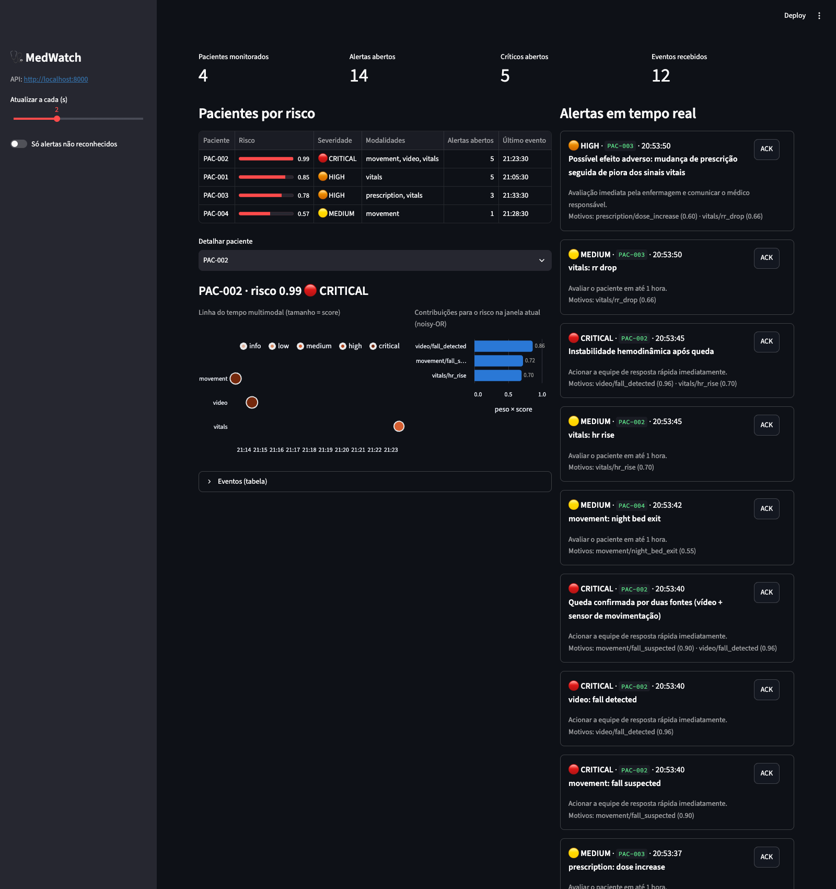

# MedWatch — Monitoramento Multimodal de Pacientes

Tech Challenge Fase 4 (POS Tech IADT) — Grupo 54.

Sistema que analisa e funde dados multimodais (vídeo, áudio e texto/sinais vitais) para identificar sinais precoces de risco e alertar a equipe médica, usando modelos locais (OpenPose / YOLOv8) e serviços gerenciados Azure AI (Speech to Text e Language/Text Analytics).

- Arquitetura: [docs/architecture.md](docs/architecture.md)
- Plano de desenvolvimento e checklists de PR: [docs/plano_desenvolvimento.md](docs/plano_desenvolvimento.md)

## Status

| Módulo | Status |
|---|---|
| Setup / infraestrutura (PR 1) | ✅ |
| Core: eventos e alertas (PR 2) | ✅ |
| Sinais vitais (PR 3) | ✅ |
| Áudio + Azure (PR 4) | ✅ |
| Vídeo: YOLOv8 + OpenPose (PR 5) | ✅ |
| Prescrições e movimentação (PR 6) | ✅ |
| Fusão, API e Dashboard (PR 7) | ✅ |
| Relatório técnico e demo (PR 8) | ⏳ |

## Pré-requisitos

- Python 3.11 ou 3.12
- ffmpeg (`brew install ffmpeg` / `apt install ffmpeg`)
- Docker (opcional)
- Azure CLI (`az`) e uma assinatura Azure (para os módulos de áudio)

## Setup local

```bash
python3.11 -m venv .venv && source .venv/bin/activate
make install          # pip install -r requirements.txt + hook do pre-commit
cp .env.example .env  # preencha as variáveis Azure
medwatch healthcheck
```

## Setup com Docker

```bash
make docker-build
docker compose run --rm medwatch healthcheck
make up      # API em :8000, dashboard em :8501 e o simulador enviando o cenário da demo
```

## Provisionamento Azure

O projeto roda localmente; o Azure é usado apenas como API (Speech to Text e Language/Text Analytics, requisitos obrigatórios do enunciado). Nada é hospedado no Azure. O plano gratuito **F0** basta para o projeto (cerca de 5 h de áudio/mês no Speech e 5 mil registros de texto/mês no Language).

### Opção A — Portal Azure (sem instalar nada)

1. Crie uma conta em https://azure.microsoft.com/free/students (Azure for Students, sem cartão) ou use uma assinatura pessoal.
2. No portal, crie um recurso **Speech** (busque por "Speech services"):
   - Região: **Brazil South** · Tipo de preço: **Free F0**
   - Depois de criado: menu **Chaves e Ponto de Extremidade** → copie a **Chave 1** e a **Região**.
3. Crie um recurso **Language** (busque por "Language service"; pule os recursos adicionais e aceite o aviso de IA Responsável):
   - Região: **Brazil South** · Tipo de preço: **Free F0**
   - Em **Chaves e Ponto de Extremidade** → copie a **Chave 1** e o **Ponto de extremidade**.
4. Crie o `.env` e preencha:

```bash
cp .env.example .env
# AZURE_SPEECH_KEY=<chave 1 do Speech>
# AZURE_SPEECH_REGION=brazilsouth
# AZURE_LANGUAGE_ENDPOINT=<ponto de extremidade do Language>
# AZURE_LANGUAGE_KEY=<chave 1 do Language>
```

### Opção B — Azure CLI

```bash
brew install azure-cli   # ou https://learn.microsoft.com/cli/azure/install-azure-cli
az login
./scripts/provision_azure.sh   # cria RG, Speech (F0) e Language (F0) em brazilsouth
```

O script imprime as variáveis para copiar no `.env`.

### Validação

```bash
medwatch healthcheck --online
```

Deve mostrar ✅ em `azure.speech.online` e `azure.language.online`. Se aparecer ❌, o log indica a causa (chave recusada com HTTP 401, endpoint inacessível etc.).

> O `.env` está no `.gitignore`: nunca commite chaves. Limite do F0: um recurso gratuito de cada tipo por assinatura.

Para remover tudo ao final: apague o grupo de recursos no portal (ou `az group delete -n rg-medwatch-g54`).

## Variáveis de ambiente

| Variável | Padrão | Descrição |
|---|---|---|
| `MEDWATCH_ENV` | `dev` | `dev`, `test` ou `prod` |
| `MEDWATCH_LOG_LEVEL` | `INFO` | Nível de log no console |
| `MEDWATCH_LOG_JSON` | `false` | Log do console em JSON |
| `MEDWATCH_AZURE_MOCK` | `false` | Usa respostas gravadas no lugar do Azure (CI/offline) |
| `MEDWATCH_POSE_BACKEND` | `yolo` | `yolo` (YOLOv8-pose) ou `openpose` |
| `MEDWATCH_DATA_DIR` / `MODELS_DIR` / `OUTPUTS_DIR` | `./data`, `./models`, `./outputs` | Diretórios de trabalho |
| `MEDWATCH_ALERT_MIN_SEVERITY` | `medium` | Severidade mínima para um evento virar alerta |
| `MEDWATCH_ALERT_COOLDOWN_MINUTES` | `15` | Janela de supressão de alertas repetidos |
| `MEDWATCH_ALERT_WEBHOOK_URL` | — | Webhook opcional para receber os alertas |
| `MEDWATCH_ALERT_WEBHOOK_FORMAT` | `generic` | `generic`, `teams`, `slack` ou `discord` |
| `MEDWATCH_API_URL` | `http://localhost:8000` | API usada pelo dashboard e por `simulate --target api` |
| `MEDWATCH_TIMEZONE` | `America/Sao_Paulo` | Fuso dos horários no dashboard (a API usa UTC) |
| `AZURE_SPEECH_KEY` | — | Chave do recurso Speech |
| `AZURE_SPEECH_REGION` | `brazilsouth` | Região do recurso Speech |
| `AZURE_SPEECH_LANGUAGE` | `pt-BR` | Idioma da transcrição |
| `AZURE_LANGUAGE_ENDPOINT` | — | Endpoint do recurso Language |
| `AZURE_LANGUAGE_KEY` | — | Chave do recurso Language |

## Sinais vitais

Detecção de anomalias em sinais vitais do **MIMIC-IV Clinical Database Demo** (PhysioNet, acesso aberto, 100 pacientes), combinando três técnicas: **NEWS2** (risco clínico absoluto), **z-score robusto** (desvio em relação ao histórico do próprio paciente) e **Isolation Forest** (combinação rara de sinais na população). Método, calibração e resultados em [docs/relatorio_vitais.md](docs/relatorio_vitais.md).

```bash
medwatch data download                               # ~6 MB, confere o SHA-256 de cada arquivo
medwatch vitals list                                 # pacientes disponíveis (subject_id)
medwatch vitals analyze --patient 10004235           # eventos + outputs/reports/vitals_<id>.json e vitals_<id>_<stay>.png
medwatch vitals analyze --patient 10004235 --alert   # envia os eventos ao AlertManager
medwatch vitals evaluate                             # precision/recall/F1 com anomalias injetadas
```

Resultado da avaliação (283 anomalias sintéticas injetadas em 116 internações reais, as que têm pelo menos 24 h de dados, seed 42):

| Método | Precision | Recall | F1 |
|---|---|---|---|
| z-score robusto | 1,000 | 0,767 | 0,868 |
| Isolation Forest | 0,949 | 0,191 | 0,318 |
| NEWS2 | 0,753 | 0,187 | 0,300 |
| **Combinado** | **0,940** | **0,830** | **0,882** |

A precision é **de injeção**, não clínica: mede quantas das detecções novas, que surgiram com a injeção, coincidem com uma anomalia injetada. A precision clínica real exigiria rótulos de especialistas (ver [relatório](docs/relatorio_vitais.md#avaliação)).

Limiares clínicos e parâmetros dos detectores ficam em [configs/thresholds.yaml](configs/thresholds.yaml).

## Vídeo clínico

Análise postural com **YOLOv8-pose** (padrão) ou **OpenPose** (rede original da CMU em PyTorch), detecção de objetos e áreas críticas com **YOLOv8 + ByteTrack**, contagem de repetições, desvios de exercício, **detecção de quedas** e relatório automático. Método e resultados em [docs/relatorio_video.md](docs/relatorio_video.md).

```bash
medwatch data download --dataset videos      # vídeos de exemplo (licença aberta)
medwatch video analyze agachamento_unipodal.webm --exercise agachamento_unipodal
medwatch video analyze agachamento_barra.webm --exercise agachamento --backend openpose
medwatch video analyze urfall_queda_01.mp4 --alert          # queda → alerta CRITICAL
medwatch video analyze meu_video.mp4 --scene quarto         # áreas críticas (ativa objetos)
medwatch video analyze meu_video.mp4 --start-time 2026-10-19T14:30:00-03:00  # horário real

medwatch data download --dataset urfall      # 40 sequências do UR Fall Dataset
medwatch video evaluate-falls                # acurácia: calibração 01–10, validação 11–20
```

Exercícios disponíveis: `agachamento`, `agachamento_unipodal` e `elevacao_bracos`. Limiares, cenas e áreas críticas ficam em [configs/video_rules.yaml](configs/video_rules.yaml). Os pesos dos modelos são baixados para `models/` no primeiro uso, com SHA-256 conferido (YOLOv8n, YOLOv8n-pose e OpenPose).

Cada análise gera em `outputs/reports/video/` um relatório HTML autocontido, um JSON com os eventos, o vídeo anotado e a série de pose (`.parquet`). Sem `--start-time`, os eventos são datados a partir do momento da análise; para fundir com os vitais e o áudio, informe o início real da gravação. Se o OpenCV não tiver H.264 (caso do pip no Linux/Docker), o vídeo anotado é convertido com o `ffmpeg` para abrir no navegador.

Detecção de quedas (UR Fall Dataset, conjunto de validação 11–20, sem ajuste de limiares):

| Backend | Quedas detectadas | Alarmes falsos | Velocidade |
|---|---|---|---|
| YOLOv8-pose | 6/10 | 0/10 | 43–105 quadros/s |
| OpenPose | 4/10 | 0/10 | 2–11 quadros/s |

## Prescrições

Anomalias na evolução das prescrições do **MIMIC-IV demo** (`hosp/prescriptions`: 14.391 prescrições em 250 internações). Método e resultados em [docs/relatorio_prescricoes_movimentacao.md](docs/relatorio_prescricoes_movimentacao.md).

```bash
medwatch prescriptions list                              # pacientes, internações e prescrições
medwatch prescriptions analyze --patient 10004235        # eventos + outputs/reports/prescriptions_<id>.json/.png
medwatch prescriptions analyze --patient 10004235 --alert
medwatch prescriptions evaluate                          # precision/recall/F1 com anomalias injetadas
```

| Regra | O que detecta | Severidade |
|---|---|---|
| Salto de dose | nova prescrição da mesma droga e via em até 24 h com dose ≥ 3× ou ≤ ⅓ da anterior | medium |
| Duplicidade terapêutica | duas drogas da mesma classe (opioides, anticoagulantes, benzodiazepínicos) ativas juntas por ≥ 24 h | low |
| Suspensão precoce | suspensa em até 4 h e não represcrita nas 24 h seguintes | low |
| Padrão do dia (Isolation Forest) | dia com volume atípico de prescrições novas, suspensas e alterações | low a high, pelo score |

Medicamentos potencialmente perigosos (lista do ISMP) sobem um nível de severidade. As doses são convertidas para a mesma unidade antes da comparação (1000 mg = 1 g). Drogas tituladas por protocolo, como insulina em escala móvel e drogas vasoativas, ficam fora da regra de salto de dose. Os limiares ficam em [configs/prescriptions.yaml](configs/prescriptions.yaml).

Resultado (anomalias injetadas em 178 internações reais com pelo menos 3 dias de prescrições, seed 42): regras com precision **0,874**, recall **0,883** e F1 **0,878**. Nos dados reais sem injeção, são 0,16 alerta ≥ medium por paciente-dia.

## Movimentação

Padrões de movimentação durante a internação a partir de uma série por minuto com `activity` (intensidade de movimento) e `in_bed` (no leito ou fora). A série pode vir de sensor de leito/acelerômetro ou da série de pose do vídeo.

```bash
medwatch movement analyze --patient SIM-001 --alert     # internação simulada com uma anomalia de cada tipo
medwatch movement analyze --input serie.parquet --patient PAC-001
medwatch movement from-pose outputs/reports/video/<vídeo>_pose.parquet \
  --start-time 2026-10-19T14:30:00-03:00 --output movimento.parquet
medwatch movement evaluate                               # precision/recall/F1 com anomalias injetadas
```

| Regra | O que detecta | Severidade |
|---|---|---|
| Imobilidade prolongada | no leito sem se mover por 120 min (reposicionamento) e por 240 min | medium → high |
| Saída noturna do leito | fora do leito por ≥ 3 min entre 22h e 6h | medium |
| Queda suspeita | pico de movimento seguido de pessoa parada fora do leito | critical |
| Queda de atividade | atividade do dia abaixo da metade da mediana dos dias anteriores | low |

Não existe dataset público de movimentação contínua em internação, então a avaliação usa internações sintéticas com confusores realistas (ida à poltrona, falhas do sensor) e anomalias injetadas (30 pacientes × 7 dias, seed 42): F1 combinado de **0,912**. A queda suspeita gera alarmes falsos em transferências bruscas para a poltrona (26 a 27 em 210 paciente-dias). O sensor sozinho não distingue a poltrona do chão, e por isso a fusão confirma a queda com o vídeo (regra `fall_confirmed`, seção [Fusão multimodal e tempo real](#fusão-multimodal-e-tempo-real)).

## Alertas

Todos os módulos publicam eventos clínicos em um barramento; o `AlertManager` os transforma em alertas para a equipe médica (detalhes em [docs/architecture.md](docs/architecture.md#contratos-de-dados-e-fluxo-de-alertas)).

```bash
medwatch alerts demo
```

Dispara um cenário fictício pelo fluxo completo e mostra os alertas no console. Resultado esperado: `Alertas enviados: 4 · suprimidos (cooldown): 1 · ignorados (< medium): 1`. O histórico fica em `outputs/alerts/alerts.jsonl`, um alerta JSON por linha.

O cenário cobre os comportamentos do gerenciador:

- alerta repetido (mesmo paciente e tipo) dentro do cooldown é **suprimido**;
- piora de severidade (HIGH → CRITICAL) **sempre passa**, mesmo dentro do cooldown;
- evento abaixo de `MEDWATCH_ALERT_MIN_SEVERITY` é **ignorado**.

Fora do cenário, vale também: se nenhum canal conseguir entregar o alerta, o cooldown não é registrado e a próxima repetição é enviada normalmente. O webhook não recebe o `evidence` dos eventos (só tipo, score e horário); o registro completo fica no `alerts.jsonl`.

**Receber os alertas no celular/chat (opcional):** crie um webhook e configure no `.env`:

| Destino | Como criar | `MEDWATCH_ALERT_WEBHOOK_FORMAT` |
|---|---|---|
| Discord | Canal → Editar canal → Integrações → Webhooks → Novo webhook → Copiar URL | `discord` |
| Slack | App "Incoming Webhooks" → Add New Webhook to Workspace | `slack` |
| Teams | Canal → Workflows → "Post to a channel when a webhook request is received" | `teams` |

```dotenv
MEDWATCH_ALERT_WEBHOOK_URL=<url do webhook>
MEDWATCH_ALERT_WEBHOOK_FORMAT=discord
```

A URL do webhook dá acesso de escrita ao canal: mantenha-a só no `.env`.

## Fusão multimodal e tempo real

O `RiskEngine` recebe os eventos de todos os módulos e combina as modalidades por paciente (detalhes e diagrama de sequência em [docs/architecture.md](docs/architecture.md#fusão-multimodal)). Cada evento pode gerar três tipos de alerta:

- **Direto**: o próprio evento, com a severidade dele. Um evento isolado nunca escala.
- **Regra cross-modal** (`fusion.<regra>`): por exemplo, falta de ar no áudio + queda de SpO2 nos vitais em até 30 min → CRITICAL. Há 5 regras em [configs/fusion.yaml](configs/fusion.yaml): piora respiratória, queda confirmada, instabilidade após queda, efeito adverso de medicamento e alteração neurológica.
- **Risco combinado** (`fusion.risk_score`): noisy-OR ponderado `R = 1 − Π(1 − w·score)` na janela de 30 min. Dois sinais fracos de modalidades diferentes podem virar um alerta MEDIUM, mesmo que nenhum deles alerte sozinho.

```bash
make demo                                   # = medwatch simulate --scenario demo (~40 s)
medwatch simulate --speed 0                 # sem esperar
medwatch simulate --replay outputs/reports/vitals_10004235.json --replay-patient PAC-010 --only-replay
```

O cenário `demo` ([configs/scenarios/demo.yaml](configs/scenarios/demo.yaml)) tem 4 pacientes fictícios em 40 minutos de internação, e o comando confere o resultado contra a sequência documentada:

| Min | Paciente | Alerta | Severidade | Por quê |
|---|---|---|---|---|
| 3 | PAC-001 | `fusion.risk_score` | medium | FC ↑ (low) + cansaço na consulta (low): nenhum alertaria sozinho |
| 6 | PAC-001 | `audio.dyspnea_terms` / `fusion.risk_score` | medium / high | relata falta de ar; o risco combinado sobe |
| 10 | PAC-001 | `vitals.spo2_drop` / `fusion.respiratory_deterioration` | high / **critical** | SpO2 88% + falta de ar |
| 15 | PAC-003 | `prescription.dose_increase` | medium | morfina IV triplicada |
| 20–21 | PAC-002 | `movement.fall_suspected`, `video.fall_detected`, `fusion.fall_confirmed` | critical | queda vista pelo sensor e pelo vídeo |
| 25 | PAC-004 | `movement.night_bed_exit` | medium | evento isolado: não escala |
| 30 | PAC-002 | `vitals.hr_rise` / `fusion.post_fall_instability` | medium / **critical** | taquicardia após a queda |
| 40 | PAC-003 | `vitals.rr_drop` / `fusion.adverse_drug_event` | medium / **high** | FR 8 irpm 25 min após o aumento do opioide |

Resultado: 14 alertas enviados, 2 suprimidos (nova queda de SpO2 no minuto 12, dentro do cooldown) e 2 eventos LOW sem alerta. A latência do evento ao alerta foi de 3,5 ms na mediana e 5,7 ms no máximo, medida a 600× com canais console + JSONL. O teste de integração exige < 2 s.

**API e dashboard.** Use três terminais, ou `make up` com Docker:

```bash
medwatch api                          # http://localhost:8000/docs
medwatch dashboard                    # http://localhost:8501
medwatch simulate --target api        # envia o cenário à API em tempo real
```

| Endpoint | O que faz |
|---|---|
| `POST /ingest/events` | Recebe `ClinicalEvent`s já processados (simulador ou outro módulo) |
| `POST /ingest/audio` | Upload da consulta (`file`, `patient_id`, `start_time`): Azure Speech + Language e eventos |
| `POST /ingest/video` | Upload do vídeo (`file`, `patient_id`, `exercise`, `scene`, `backend`): pose, quedas e áreas críticas |
| `GET /patients` | Pacientes do maior risco para o menor, com as contribuições de cada modalidade |
| `GET /patients/{id}/risk` | Risco atual e linha do tempo multimodal do paciente |
| `GET /alerts` · `POST /alerts/{id}/ack` | Alertas entregues (filtros `patient_id`, `acked`) e reconhecimento pela equipe |
| `WS /ws/alerts` | Feed em tempo real: `{"type": "alert" \| "ack", "alert": {...}}` |
| `GET /health` | Estado da API e do consumidor de eventos |



O estado da API fica em memória: reiniciar zera pacientes e alertas. O histórico permanente fica em `outputs/alerts/alerts.jsonl`, e os ACKs em `outputs/alerts/acks.jsonl`. Os uploads aceitam só as extensões esperadas e têm limite de tamanho. O `patient_id` precisa ser um código (letras, números, `-` e `_`), porque vira nome de arquivo do relatório.

## Áudio

Analisa a gravação de uma consulta e gera eventos `source=audio` para o `AlertManager`:

```bash
medwatch audio analyze consulta.wav --patient PAC-001 --start-time 2026-10-19T14:30:00-03:00
medwatch audio analyze consulta.wav --patient PAC-001 --alert        # envia os eventos aos canais
medwatch audio analyze consulta.wav --patient PAC-001 --diarize      # separa médico × paciente
medwatch audio analyze nova.wav --patient PAC-001 \
  --baseline outputs/reports/audio_PAC-001_<data>.json              # compara com a consulta anterior
```

| Etapa | Onde roda | O que faz |
|---|---|---|
| Pré-processamento | local | `.wav`, `.flac`, `.ogg` ou `.mp3` → PCM 16 kHz mono (taxa nativa do Azure Speech; 44,1 kHz só aumentaria o envio); valida tamanho e duração (3 s a 30 min) |
| Azure Speech to Text | Azure | Reconhecimento contínuo em pt-BR, com tempo por palavra e diarização opcional |
| Azure AI Language | Azure | Sentimento com opinion mining, frases-chave, resumo da consulta e Text Analytics for Health (sintomas, medicamentos e negação) |
| Termos críticos | local | `configs/critical_terms.yaml`: dispneia, fadiga, dor torácica, sintomas neurológicos e sangramento |
| Features acústicas | local | F0 (média e variação em semitons), jitter, shimmer, HNR, pausas, taxa de fala e de articulação |
| Indicadores | local | Fadiga, disartria e dificuldade respiratória por z-score contra o baseline (`configs/audio.yaml`) |

**Termos críticos.** Cada menção é classificada como afirmada, negada ou pergunta, e só as afirmadas geram evento:
- "Estou com falta de ar" é **afirmada**;
- "Não tenho falta de ar" e "Dor no peito, não" são **negadas**;
- "Sentiu falta de ar?" é **pergunta**, porque sem diarização é a fala do médico.

A negação vem do dicionário local e, quando disponível, da asserção do Text Analytics for Health.

**Indicadores são triagem, não diagnóstico.** Cada feature vira um z-score orientado (positivo = na direção do achado), e o indicador é a média ponderada desses z com piso 0: uma feature melhor que o baseline não compensa o desvio de outra. Com z ≥ 1,5 o indicador é `low`, com z ≥ 2 é `medium` e com z ≥ 3 é `high`. Um termo crítico afirmado da mesma família (ex.: "falta de ar" no indicador respiratório) sobe a severidade em um nível. O baseline padrão é uma referência populacional aproximada. Com `--baseline`, a comparação é com uma consulta anterior do próprio paciente, que é bem mais confiável.

**Limitação conhecida: indicadores acústicos com o baseline populacional.** Sem `--baseline`, a consulta fictícia **normal** (`consulta_01_normal.wav`) gera um falso positivo de **disartria HIGH** (z = +3,3). Há duas causas:
- **O áudio tem dois falantes.** As features são medidas no áudio inteiro, com médico e paciente juntos. A troca de voz infla o jitter (2,4%), o shimmer (8,5%) e a variação de F0 (5,9 semitons, quase o dobro de uma pessoa só).
- **O baseline de jitter e shimmer vem de vogal sustentada.** Os limiares do Praat (jitter 1,04%, shimmer 3,81%) são de exame de voz com "aaaa" contínuo. Em fala conversacional esses valores são naturalmente mais altos.

Com a consulta normal como `--baseline` da consulta com dispneia, a disartria cai de z = +2,9 para +0,3 e não gera evento. Ficam só os eventos de termos (`dyspnea_terms` MEDIUM e `fatigue_terms` LOW). Por isso, a demonstração usa `--baseline`, e os indicadores acústicos sem baseline devem ser lidos com cautela.

A voz sintética também não imita falta de ar: com `--baseline`, o indicador de dificuldade respiratória fica em z = 0 nas amostras do Azure TTS. Só a gravação com voz real ([docs/roteiro_gravacao_audio.md](docs/roteiro_gravacao_audio.md)) mostra esse indicador.

Como evolução, as features poderiam ser medidas só nos trechos da paciente, com `--diarize`, e o baseline recalibrado para fala conversacional.

**Resumo da consulta.** O padrão é o resumo **extrativo**: escolhe as frases mais representativas da própria consulta e mantém a ordem em que foram ditas. O resumo **abstrativo**, em que o modelo reescreve o texto, não está disponível em Brazil South. Para usá-lo, crie o recurso Language numa região suportada (ex.: East US, North Europe) e troque `summary_mode` em `configs/audio.yaml`. As frases-chave vêm do mesmo serviço.

**Saída.** O relatório fica em `outputs/reports/audio_<paciente>_<data>.json`, com transcrição, resumo, frases-chave, sentimento, entidades, termos, features, indicadores e eventos. Ele contém a transcrição completa: é dado de saúde e não deve ser anexado a issues, PRs ou mensagens. Os eventos e alertas carregam só metadados (categoria, termos do dicionário, contagens, z-scores); resumo e frases-chave ficam fora deles. O que vai para o Azure e o que fica local está em [docs/adr/0003-lgpd-audio-azure.md](docs/adr/0003-lgpd-audio-azure.md).

**Amostras e modo offline.**

```bash
medwatch audio synth-samples                    # gera data/samples/consulta_0*.wav com Azure TTS
medwatch audio analyze data/samples/consulta_02_dispneia.wav --patient PAC-001 --record
MEDWATCH_AZURE_MOCK=true medwatch audio analyze data/samples/consulta_02_dispneia.wav --patient PAC-001
```

- O `--record` grava as respostas do Azure em `data/samples/azure/<hash do áudio>.*.json`.
- Com `MEDWATCH_AZURE_MOCK=true`, essas respostas são reaproveitadas sem chamar o Azure (é o modo do CI).
- Grave assim **somente consultas fictícias**: esse diretório vai para o git.
- Para gravar com voz real, siga [docs/roteiro_gravacao_audio.md](docs/roteiro_gravacao_audio.md).
- Gravações em `.m4a` (iPhone) precisam ser convertidas antes: `ffmpeg -i consulta.m4a -ac 1 -ar 16000 consulta.wav`.

## Comandos de desenvolvimento

```bash
make lint     # ruff + mypy
make format   # aplica correções de estilo
make test     # testes sem Azure real e sem modelos pesados
make demo     # cenário multimodal no terminal: eventos → fusão → alertas
make up       # Docker: API (:8000), dashboard (:8501) e simulador da demo
```

## Estrutura

```
src/medwatch/   código (core, video, audio, anomaly, fusion, streaming, api, dashboard)
configs/        limiares, regras e pesos (YAML)
data/           datasets (raw/processed fora do git; samples versionados)
models/         pesos de modelos (fora do git)
outputs/        relatórios, alertas e logs (fora do git)
scripts/        provisionamento Azure e download de datasets
docs/           arquitetura, ADRs, relatório técnico
tests/          unit e integration
```
