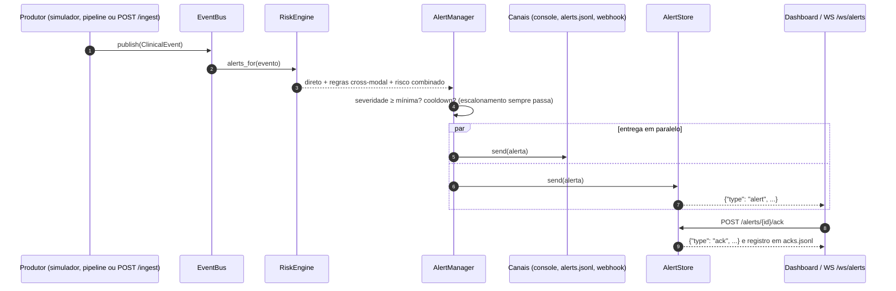

# Arquitetura — MedWatch

## Decisões principais

| Decisão | Escolha | Justificativa |
|---|---|---|
| Processamento de vídeo | Local/edge (OpenPose / YOLOv8) | Vídeo de paciente é dado sensível (LGPD); evita enviar imagem identificável à nuvem e reduz custo de banda. |
| Processamento de áudio | Azure Speech to Text + Azure AI Language, mais features acústicas locais | Requisito obrigatório; região `brazilsouth`. Pitch, pausas e jitter são extraídos localmente para não depender só do texto. |
| Estimativa de pose | Interface `PoseEstimator` com backends YOLOv8-pose (padrão) e OpenPose (rede original da CMU portada para PyTorch) | O OpenPose oficial exige compilação com CUDA e o OpenCV 5 removeu o importador Caffe. Ambos os backends são normalizados para COCO-17. Ver [ADR 0002](adr/0002-backends-de-pose.md). |
| Fusão | Late fusion orientada a eventos | Cada módulo emite `ClinicalEvent`s padronizados; o `RiskEngine` agrega por paciente numa janela deslizante. Módulos são desenvolvidos e testados isoladamente. |
| Tempo real | Simulador (replay acelerado de PhysioNet/MIMIC) → barramento assíncrono → FastAPI + WebSocket → Dashboard | Viável no escopo acadêmico; o barramento é uma interface e pode ganhar um adapter para Azure Event Hubs. |
| Nomenclatura Azure | "Cognitive Services" = Azure AI Services; Text Analytics faz parte do Azure AI Language | Registrado para evitar ambiguidade. |

## Diagrama

```
                         ┌──────────────────────── FONTES DE DADOS ─────────────────────────┐
                         │ Vídeos (fisio/quarto/cirurgia) │ Áudios consultas │ PhysioNet / MIMIC-IV demo │
                         └──────────┬─────────────────────┴────────┬─────────┴──────────┬────────────────┘
                                    │                              │                    │
                 ┌──────────────────▼──────────┐   ┌───────────────▼───────────┐  ┌─────▼─────────────────────┐
                 │  VIDEO PIPELINE (local)     │   │  AUDIO PIPELINE           │  │ STREAM SIMULATOR (replay) │
                 │  OpenCV frame sampler       │   │  ffmpeg → wav 16k mono    │  │ sinais vitais 1Hz         │
                 │  ├─ YOLOv8 (objetos/ROIs)   │   │  ├─ Acústica local        │  │ prescrições (eventos)     │
                 │  ├─ OpenPose | YOLOv8-pose  │   │  │  (librosa/parselmouth: │  └─────┬─────────────────────┘
                 │  ├─ Regras: ângulos,        │   │  │  F0, jitter, shimmer,  │        │
                 │  │  assimetria, queda, ROI  │   │  │  HNR, pausas)          │        │
                 │  └─ Série temporal de pose ─┼─┐ │  ├─ Azure Speech to Text ─┼──┐     │
                 │  Relatório (HTML/JSON + PNG)│ │ │  └─ Azure AI Language  ◄──┼──┘     │
                 └──────────────┬──────────────┘ │ │     (Sentiment, Health,   │        │
                                │                │ │      termos críticos)     │        │
                                │                │ └────────────┬──────────────┘        │
                                │      ┌─────────▼──────────────┼───────────────────────▼──────────┐
                                │      │            ANOMALY DETECTION                              │
                                │      │  vitals: limiares clínicos (NEWS2) + z-score robusto      │
                                │      │          + Isolation Forest (janelas)                     │
                                │      │  prescrições: regras (dose Δ, alto risco, duplicidade)    │
                                │      │          + Isolation Forest (paciente-dia)                │
                                │      │  movimentação: imobilidade, saída do leito, queda         │
                                │      └─────────┬─────────────────────────────────────────────────┘
                                ▼                ▼
                 ┌───────────────────────────────────────────────────────────┐
                 │  EVENT BUS (asyncio; adapter p/ Azure Event Hubs opcional) │
                 │  ClinicalEvent{patient_id, source, type, score, severity,  │
                 │                evidence, artifacts, timestamp}             │
                 └──────────────────────────┬────────────────────────────────┘
                                            ▼
                 ┌───────────────────────────────────────────────────────────┐
                 │  FUSION / RISK ENGINE                                      │
                 │  janela deslizante por paciente · noisy-OR ponderado       │
                 │  regras de escalonamento cross-modal (ex.: "falta de ar"   │
                 │  no áudio + queda de SpO2 em 10 min → CRITICAL)            │
                 │  dedup + cooldown                                          │
                 └──────────────────────────┬────────────────────────────────┘
                                            ▼
                 ┌───────────────────────────────────────────────────────────┐
                 │  ALERT MANAGER → console/log · alerts.jsonl · webhook      │
                 │                  (Teams/Slack) · WebSocket                 │
                 └──────────────────────────┬────────────────────────────────┘
                                            ▼
                     FastAPI (/ingest, /alerts, /ws/alerts)  ──►  Dashboard Streamlit (equipe médica)
```

## Contratos de dados e fluxo de alertas

Implementados em `src/medwatch/core/` (decisão registrada no [ADR 0001](adr/0001-late-fusion-event-driven.md)).

- **`ClinicalEvent`** (`core/events.py`, imutável): `event_id` (uuid), `patient_id` (pseudonimizado), `source` (`video` | `audio` | `vitals` | `prescription` | `movement` | `fusion`), `type` (snake_case, ex.: `spo2_drop`), `timestamp` (sempre normalizado para UTC; horário sem fuso é rejeitado), `score` ∈ [0, 1], `severity`, `evidence` (somente valores JSON, congelado em profundidade, já que o mesmo evento vai para vários assinantes), `artifacts` (caminhos de relatórios/frames).
- **`Severity`**: `info` < `low` < `medium` < `high` < `critical`. A comparação usa a ordem clínica, não a alfabética.
- **`Alert`** (imutável): `alert_id`, `patient_id`, `alert_type`, `severity`, `title`, `reasons` (≥ 1 evento), `recommended_action` (derivada da severidade), `created_at`, `acked`. `Alert.from_event()` cria o alerta direto de um evento.
- **`EventBus`** (`core/bus.py`): protocolo com `publish`, `subscribe` e `close`. `InMemoryEventBus` faz fan-out para filas por assinante (`async for event in subscription`). Uma fila limitada descarta o evento mais antigo em vez de travar os produtores.
- **`AlertManager`** (`core/alerts/manager.py`): entrega cada alerta a todos os canais em paralelo. Uma falha em um canal é logada e não afeta os demais. Alertas com a mesma chave (paciente + `alert_type`) dentro do cooldown são suprimidos, **exceto se a severidade subir**. O cooldown só começa a contar quando pelo menos um canal entregou o alerta: se todos falharem, a próxima repetição é tentada de novo. No `consume`, as entregas correm em paralelo (até 32 por vez), para um CRITICAL não esperar os retries de alertas anteriores. Com `clock=None`, o cooldown usa o horário dos eventos (replay de dados históricos).
- **Canais** (`core/alerts/channels.py`): `ConsoleChannel` (log com nível pela severidade), `JsonlChannel` (`outputs/alerts/alerts.jsonl`, um alerta por linha) e `WebhookChannel` (formatos `generic`, `teams` [Adaptive Card do Teams Workflows], `slack`, `discord`; repete com backoff exponencial em erro de rede, 429 e 5xx, respeitando o `Retry-After` até 30 s). Nenhum formato de webhook envia o `evidence` dos eventos; o registro completo fica no `alerts.jsonl`.

- **`RiskEngine`** (`fusion/risk_engine.py`, implementa o protocolo `AlertSource` do `AlertManager`): guarda o histórico recente de cada paciente e, para cada evento, devolve três tipos de alerta, descritos abaixo. O filtro de severidade e o cooldown continuam no `AlertManager`.

## Fusão multimodal

Configurada em `configs/fusion.yaml`. Cada evento que chega ao `RiskEngine` pode gerar:

1. **Alerta direto** (`<fonte>.<tipo>`): o próprio evento, com a severidade dele. Um evento isolado nunca escala sozinho.
2. **Regra cross-modal** (`fusion.<regra>`): combinações de modalidades dentro de uma janela, como falta de ar no áudio + queda de SpO2 nos vitais em até 30 min → CRITICAL. A regra só dispara no evento que a completa, e `reasons` traz os eventos da combinação.
3. **Risco combinado** (`fusion.risk_score`): `R = 1 − Π(1 − wₛ · scoreᵢ)` na janela de 30 min, com pesos `wₛ` por fonte. Cada (fonte, tipo) entra uma vez, pelo maior score: três `spo2_drop` seguidos não são três evidências independentes. Só alerta com ≥ 2 modalidades e quando a faixa de R supera o pior evento individual. Se uma regra já disparou com severidade igual ou maior, ela é a explicação mais clara e o risco combinado não é enviado.

| Regra | Combinação | Janela | Severidade |
|---|---|---|---|
| `respiratory_deterioration` | áudio (falta de ar, indicador respiratório) + vitais (SpO2 ↓, FR ↑) | 30 min | critical |
| `fall_confirmed` | vídeo (queda) + sensor de movimentação (queda suspeita) | 5 min | critical |
| `post_fall_instability` | queda (vídeo ou sensor) + vitais (FC ↑, PAS ↓, NEWS2 ↑) | 30 min | critical |
| `adverse_drug_event` | prescrição (aumento de dose, duplicidade) seguida de piora dos vitais (`ordered`) | 6 h | high |
| `neuro_change` | áudio (sintoma neurológico, disartria) + queda ou saída noturna do leito | 60 min | high |

Regras e alertas são avaliados no horário dos eventos, não no relógio: um replay de dados históricos gera os mesmos alertas que o tempo real, e eventos fora de ordem (o vídeo processado depois dos vitais) ainda completam uma regra. Em regras com `ordered: true`, a ordem exigida entre as condições vale pelo horário dos eventos, não pela chegada: uma piora anterior à prescrição não é atribuída a ela. Só o retrato do risco "agora" (`GET /patients`) usa o relógio, para o risco de um paciente sem eventos novos decair.

## Fluxo de alerta



Latência medida do `publish` à entrega nos canais (cenário `demo`, 12 eventos, MacBook, canais console + JSONL): mediana de 3,5 ms e máximo de 5,7 ms. O teste de integração `test_simulator_to_alert_latency_under_two_seconds` garante < 2 s no CI.

## Tempo real: simulador, API e dashboard

- **Simulador** (`streaming/simulator.py`): reproduz um cenário (`configs/scenarios/*.yaml`) com a cadência real dividida por `--speed`. Aceita eventos roteirizados e relatórios JSON já gerados pelos módulos (`--replay`), com horários rebaseados para o início da simulação a partir de uma origem comum (o primeiro evento entre todos os relatórios), para as modalidades continuarem alinhadas. Publica no barramento local ou no `POST /ingest/events` da API.
- **API** (`api/app.py`, FastAPI): `POST /ingest/events`, `POST /ingest/audio` e `POST /ingest/video` (upload que roda o pipeline do módulo numa thread e publica os eventos), `GET /patients`, `GET /patients/{id}/risk`, `GET /alerts`, `POST /alerts/{id}/ack`, `WS /ws/alerts` e `GET /health`. O estado é em memória: reiniciar a API zera pacientes e alertas, e o histórico permanente fica no `alerts.jsonl` e no `acks.jsonl`.
- **Dashboard** (`dashboard/app.py`, Streamlit): pacientes ordenados por risco, feed de alertas com ACK, linha do tempo multimodal e contribuições de cada modalidade para o risco. Lê a API a cada 2 s.

## Datasets

| Uso | Dataset | Observação |
|---|---|---|
| Sinais vitais (HR, PA, SpO2, FR, temperatura) e prescrições | MIMIC-IV Clinical Database Demo (PhysioNet, acesso aberto, 100 pacientes) | Tabelas `icu/chartevents`, `icu/d_items`, `icu/icustays` e `hosp/prescriptions`. Baixadas com `medwatch data download`, SHA-256 conferido. |
| Consultas em pt-BR | Consultas fictícias sintetizadas com Azure TTS (`medwatch audio synth-samples`) e gravação com voz real pelo roteiro ([roteiro_gravacao_audio.md](roteiro_gravacao_audio.md)) | Roteiros normal × dispneia/fadiga dão o ground truth. |
| Vídeo de fisioterapia | Vídeos de exercícios do Wikimedia Commons (CC BY / CC BY-SA) | Agachamento unipodal e agachamento com barra. |
| Quedas | UR Fall Detection Dataset (uso em pesquisa) | 40 sequências; calibração 01–10, validação 11–20. |
| Movimentação na internação | Internações sintéticas (30 pacientes × 7 dias, seed 42) | Não há dataset público de movimentação contínua em internação. |

Ainda não utilizados: **BIDMC PPG and Respiration** (previsto para o simulador de tempo real do PR 7) e **AudioSet** (os clipes são do YouTube, sem fala em pt-BR nem rótulo clínico; os indicadores vocais usam features acústicas sobre a consulta). Os pesos COCO do YOLOv8 não detectam instrumental cirúrgico: cirurgia real exigiria fine-tuning (ex.: m2cai16-tool-locations).

Avaliação: anomalias sintéticas rotuladas são injetadas em vitais, prescrições e movimentação para medir precision/recall/F1.

## Privacidade (LGPD)

- Vídeo nunca sai do ambiente local.
- Áudio é enviado ao Azure em `brazilsouth`; transcrições completas não vão para logs.
- Identificadores de paciente são pseudonimizados em eventos, alertas e logs.
