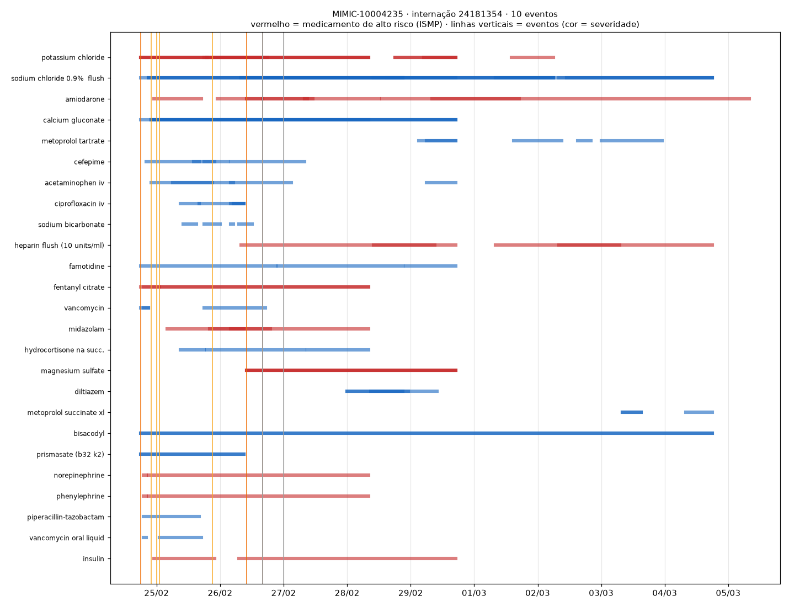
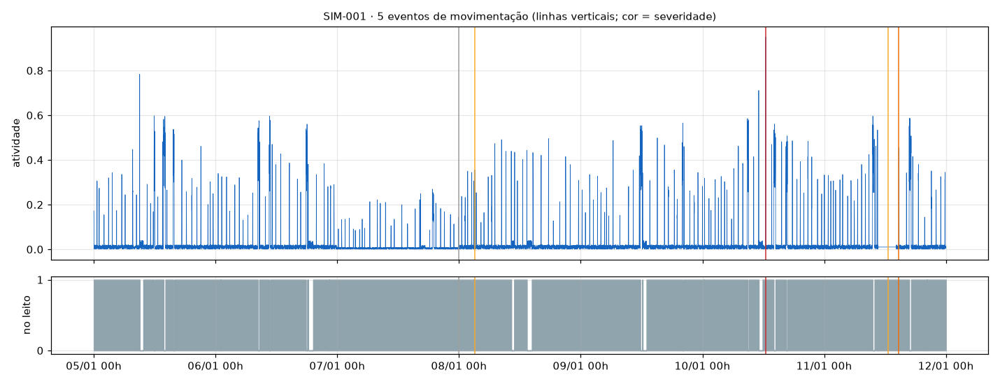

# Anomalias em prescrições e movimentação

Seção de referência para o relatório técnico (PR 8). Os números abaixo são reproduzíveis com `medwatch data download`, seguido de `medwatch prescriptions evaluate` e `medwatch movement evaluate`.

## Prescrições

### Dados

**MIMIC-IV Clinical Database Demo 2.2**, tabela `hosp/prescriptions`: 18.087 linhas, das quais 14.391 são prescrições principais (`drug_type = MAIN`). Diluentes (`BASE`) e aditivos ficam fora. São 100 pacientes, 250 internações e 2.121 paciente-dias.

**Pré-processamento:**
- **Dose:** convertida em número. Uma faixa como "1-2" vira o máximo (2) e "25,000" vira 25000.
- **Unidade:** normalizada para a base do grupo, `mcg`/`mg`/`g`/`gm` → mg e `mL`/`L` → mL. No demo, 16 drogas aparecem com mais de uma unidade (ex.: fentanil em mcg e mg). Sem normalizar, 1000 mg → 1 g pareceria uma queda de 1000×.
- **Marcações por prescrição:** medicamento potencialmente perigoso (lista do ISMP), droga titulada por protocolo e classe terapêutica.

### Técnicas

| Técnica | Pergunta que responde | Detalhes |
|---|---|---|
| **Salto de dose** | A dose mudou de forma inesperada? | Nova prescrição da mesma droga e via em até 24 h com dose ≥ 3× ou ≤ ⅓ da anterior. Severidade medium (high se a droga for de alto risco). |
| **Duplicidade terapêutica** | Há duas drogas da mesma classe ao mesmo tempo? | Opioides, anticoagulantes ou benzodiazepínicos diferentes ativos juntos por ≥ 24 h. Severidade low (medium se a classe for de alto risco, como os opioides). |
| **Suspensão precoce** | Uma prescrição foi interrompida logo depois de começar? | Suspensa em até 4 h e não represcrita nas 24 h seguintes, o que pode indicar reação adversa ou erro de prescrição. O evento sai quando a janela fecha (24 h depois da suspensão), porque só aí ele fica confirmado. |
| **Isolation Forest por paciente-dia** | O volume de mudanças no tratamento naquele dia é raro na população? | Features do dia: prescrições ativas, novas, suspensas, de alto risco e alterações de dose. Contaminação de 3%. |

**Calibração com os dados reais (sem injeção):**
- **Insulina, fenilefrina e nitroglicerina** respondem pela maioria das variações ≥ 3× entre prescrições consecutivas. Elas são tituladas à beira do leito por protocolo, e por isso as drogas tituláveis e a via "IV DRIP" ficam fora da regra de salto de dose.
- **Dobrar a dose é ajuste de rotina** (ex.: furosemida 20 → 40 mg). Com limiar de 2× seriam 972 eventos em 2.121 paciente-dias; com 3×, são 162.
- **13,6% das prescrições duram menos de 6 h.** Por isso a suspensão precoce exige que a droga não volte a ser prescrita.

Com a configuração final, os dados reais geram **566 eventos (0,27 por paciente-dia)**, dos quais **0,16 por paciente-dia são ≥ medium** e viram alerta. Nos sinais vitais, a mesma conta dá 2,9.

| Evento | Quantidade |
|---|---|
| `early_stop` | 256 |
| `duplicate_therapy` | 96 |
| `dose_increase` | 93 |
| `dose_decrease` | 69 |
| `prescription_pattern_anomaly` | 52 |

### Avaliação

Os dados reais não têm rótulo, então a avaliação injeta anomalias conhecidas nas prescrições reais de internações com pelo menos 3 dias de prescrições (178 das 250). São 2 injeções por internação, separadas por pelo menos 24 h:

| Tipo | Como é injetado | Quando passa a ser detectável |
|---|---|---|
| `dose_spike` | cópia de uma prescrição existente, 8 h depois, com 4× a dose | no início da nova prescrição |
| `duplicate_therapy` | morfina + hidromorfona IV por 36 h, num período sem opioides | quando a segunda começa |
| `early_stop` | prescrição de ≥ 24 h encurtada para 2 h, sem nova prescrição na janela | 24 h depois da suspensão |

A precision segue a mesma definição dos sinais vitais: entre as detecções que surgiram com a injeção, a fração que coincide com uma injeção, com tolerância de ±6 h. É uma precision de injeção, não clínica.

| Método | Precision | Recall | F1 | Precision | Recall | F1 |
|---|---|---|---|---|---|---|
| | *seed 42* | | | *seed 7* | | |
| Regras | 0,874 | 0,883 | 0,878 | 0,899 | 0,900 | 0,899 |
| Isolation Forest | 0,667 | 0,021 | 0,040 | 0,727 | 0,026 | 0,050 |
| **Combinado** | **0,869** | **0,886** | **0,877** | **0,894** | **0,900** | **0,897** |

Recall do método combinado por tipo (seed 42): salto de dose 0,94 · suspensão precoce 0,86 · duplicidade 0,80.

**Leitura dos resultados:**
- **As regras detectam a grande maioria das injeções.** As perdas vêm de sobreposição com prescrições reais: outra prescrição da mesma droga entre a original e a injetada muda a razão comparada, e uma duplicidade real no mesmo período faz a detecção não contar como nova.
- **O Isolation Forest quase não detecta injeções isoladas.** Uma prescrição a mais muda pouco as contagens do dia. O papel dele é outro: marcar dias de tratamento atípicos como um todo, como o primeiro dia do exemplo abaixo, com 43 prescrições novas.

### Exemplo real: paciente MIMIC-10004235

É a mesma internação do exemplo de sinais vitais ([relatorio_vitais.md](relatorio_vitais.md)), do dia 24/02 ao 05/03.

```bash
medwatch prescriptions analyze --patient 10004235 --alert
```



| Horário | Severidade | Evento | Evidência |
|---|---|---|---|
| 24/02 18:00 | high | `dose_decrease` | Cloreto de potássio 40 → 10 mEq (alto risco) |
| 25/02 00:00 | medium | `prescription_pattern_anomaly` | Dia da admissão: 43 prescrições novas, 16 de alto risco ativas |
| 25/02 01:00 | medium | `dose_increase` | Vancomicina oral 125 → 500 mg (4×) |
| 25/02 21:00 | medium | `early_stop` | Heparina suspensa após 3 h e não represcrita |
| 26/02 10:00 e 16:00 | high | `dose_decrease` / `dose_increase` | Amiodarona 600 → 150 → 600 mg |

A amiodarona é um exemplo de por que o resultado é triagem, não diagnóstico. A sequência 600 → 150 → 600 mg é compatível com a troca entre dose de ataque e de manutenção, e quem decide se é esperado é a equipe. O sistema só garante que a mudança de um medicamento de alto risco não passe despercebida.

Com `--alert`, os eventos das três internações do paciente viram 8 alertas no `alerts.jsonl`, e 3 de severidade baixa são ignorados.

## Movimentação

### Dados

**Não existe dataset público de movimentação contínua durante a internação** que combine sensor de leito com rótulos de queda, imobilidade e saída noturna. Por isso a série "normal" é sintética (`simulate_stay`), uma por minuto, com as rotinas de uma internação:

- **Noite (22h–6h):** no leito, com movimentos breves de sono a cada 20–60 min.
- **Dia:** reposicionamento a cada 30–100 min e 2–3 caminhadas de 10–25 min fora do leito.
- **Confusores:**
  - 1–2 idas à poltrona por dia, com transferência brusca e depois a pessoa parada fora do leito por 20–60 min. É o caso mais parecido com uma queda.
  - Falhas de 1 min no sensor de leito.

A mesma série pode vir do vídeo: `medwatch movement from-pose` converte o `*_pose.parquet` do módulo de vídeo. `activity` vira o deslocamento médio dos keypoints em fração da altura da pessoa, e `in_bed`, o quadril dentro do polígono do leito.

### Técnicas

| Regra | Pergunta que responde | Detalhes |
|---|---|---|
| **Imobilidade prolongada** | O paciente precisa ser reposicionado? | No leito sem se mover por 120 min (MEDIUM, referência usual de reposicionamento do NPIAP/EPUAP para prevenção de lesão por pressão). Escala para HIGH aos 240 min. Cada limiar gera o alerta no momento em que é cruzado. |
| **Saída noturna do leito** | Há risco de queda à noite? | Fora do leito por ≥ 3 min entre 22h e 6h (MEDIUM). Uma falha de 1 min do sensor não dispara. |
| **Queda suspeita** | O paciente caiu? | Pico de movimento (≥ 0,8) seguido de pessoa parada fora do leito por 2 min (CRITICAL). |
| **Queda de atividade** | O paciente está bem menos ativo que nos dias anteriores? | Atividade do dia abaixo de 50% da mediana dos 2–3 dias anteriores do próprio paciente (LOW). Pode indicar piora clínica ou delirium hipoativo. |

### Avaliação

São 30 internações sintéticas de 7 dias. Cada uma recebe 4 injeções, uma de cada tipo e em dias diferentes, e os dois primeiros dias ficam como histórico.
- **Imobilidade:** 150–300 min parado.
- **Saída noturna:** 5–15 min fora do leito, entre 1h e 4h.
- **Queda:** pico de intensidade sorteada entre 0,7 e 1,0, e depois 6 min parado fora do leito.
- **Queda de atividade:** o dia inteiro no leito, com 45% do movimento habitual.

| Tipo | Precision | Recall | F1 | Precision | Recall | F1 |
|---|---|---|---|---|---|---|
| | *seed 42* | | | *seed 7* | | |
| Imobilidade prolongada | 0,965 | 1,000 | 0,982 | 0,981 | 1,000 | 0,990 |
| Saída noturna do leito | 1,000 | 1,000 | 1,000 | 1,000 | 1,000 | 1,000 |
| Queda suspeita | 1,000 | 0,633 | 0,776 | 1,000 | 0,700 | 0,824 |
| Queda de atividade | 1,000 | 0,767 | 0,868 | 1,000 | 0,933 | 0,966 |
| **Combinado** | **0,984** | **0,850** | **0,912** | **0,992** | **0,908** | **0,949** |

**Alarmes falsos em internações normais.** A precision acima só considera as detecções novas, então não mostra o que o detector já acusa sem nenhuma anomalia. Medido à parte, em 210 paciente-dias normais saíram **27 quedas suspeitas falsas (seed 42) e 26 (seed 7)**, todas em transferências bruscas para a poltrona. Nenhuma imobilidade, saída noturna ou queda de atividade foi acusada sem motivo.

**Leitura dos resultados:**
- **Imobilidade e saída noturna** são regras de duração e quase não erram. A pequena perda de precision da imobilidade vem da queda de atividade injetada, que também deixa o paciente parado por mais de 2 h.
- **A queda é o caso difícil.** Quedas leves (pico abaixo de 0,8) não são detectadas, e transferências bruscas para a poltrona geram alarme falso. O sensor de leito não distingue poltrona de chão. **Por isso a queda suspeita pelo sensor deve ser confirmada pela queda detectada no vídeo**, que olha a postura. Esse é o papel da fusão (RiskEngine, PR 7).
- **Não ajustamos o limiar de queda para "acertar" o simulador.** Os resultados refletem a sobreposição real entre queda e transferência que o simulador reproduz.



*Exemplo de `medwatch movement analyze --patient SIM-001`: queda de atividade (dia 07/01), saída noturna (08/01, 03h), queda (10/01, 12h30) e imobilidade (11/01, MEDIUM às 12h38 e HIGH às 14h38).*

## Limitações

- **Prescrições:** usam a hora de início e de fim da prescrição, não a administração efetiva (o demo não traz a `emar` completa). A duplicidade compara pela hora de fim registrada, então em tempo real ela dependeria do fim previsto.
- **Tituláveis:** excluir as drogas tituladas da regra de salto de dose evita ruído, mas também esconde um erro real de titulação. Para elas, o caminho seria uma regra por faixa de dose máxima, que não foi implementada.
- **Movimentação:** a avaliação é inteiramente sintética. Os resultados mostram que as regras fazem o que se propõem com dados plausíveis, não a acurácia clínica. A validação real exigiria sensores de leito em pacientes internados.
- **Precision:** é de injeção, não clínica, nos dois módulos (ver as seções de avaliação).
