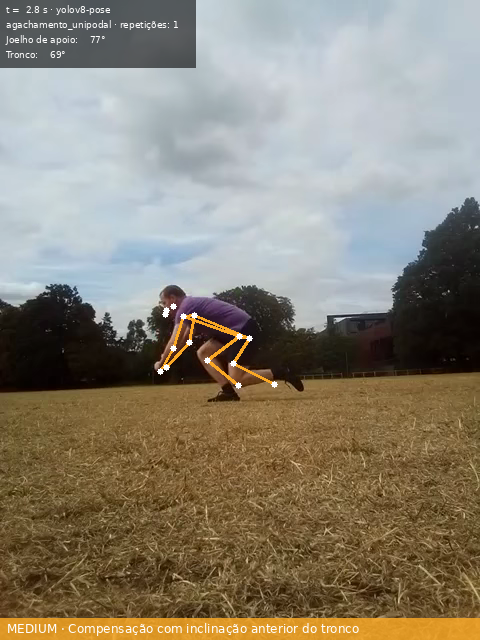
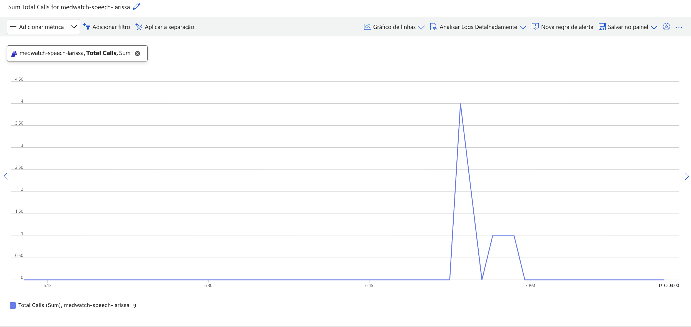
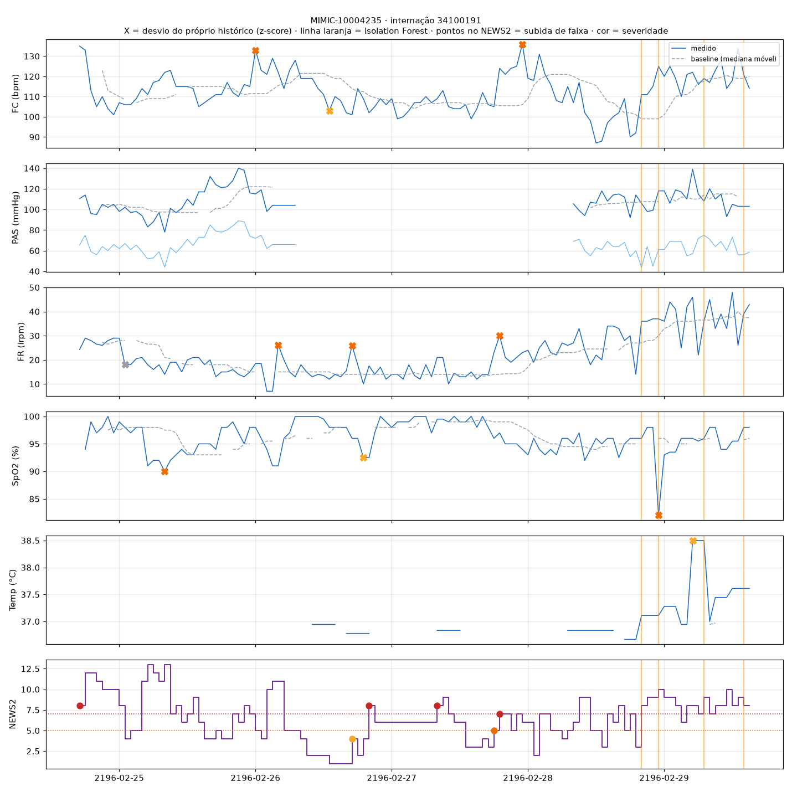
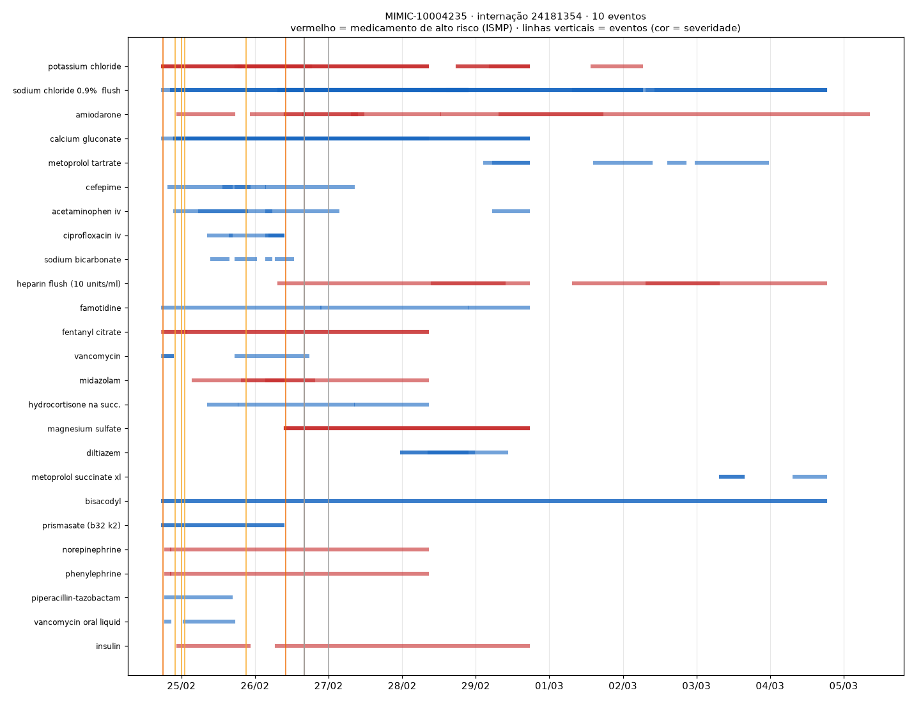
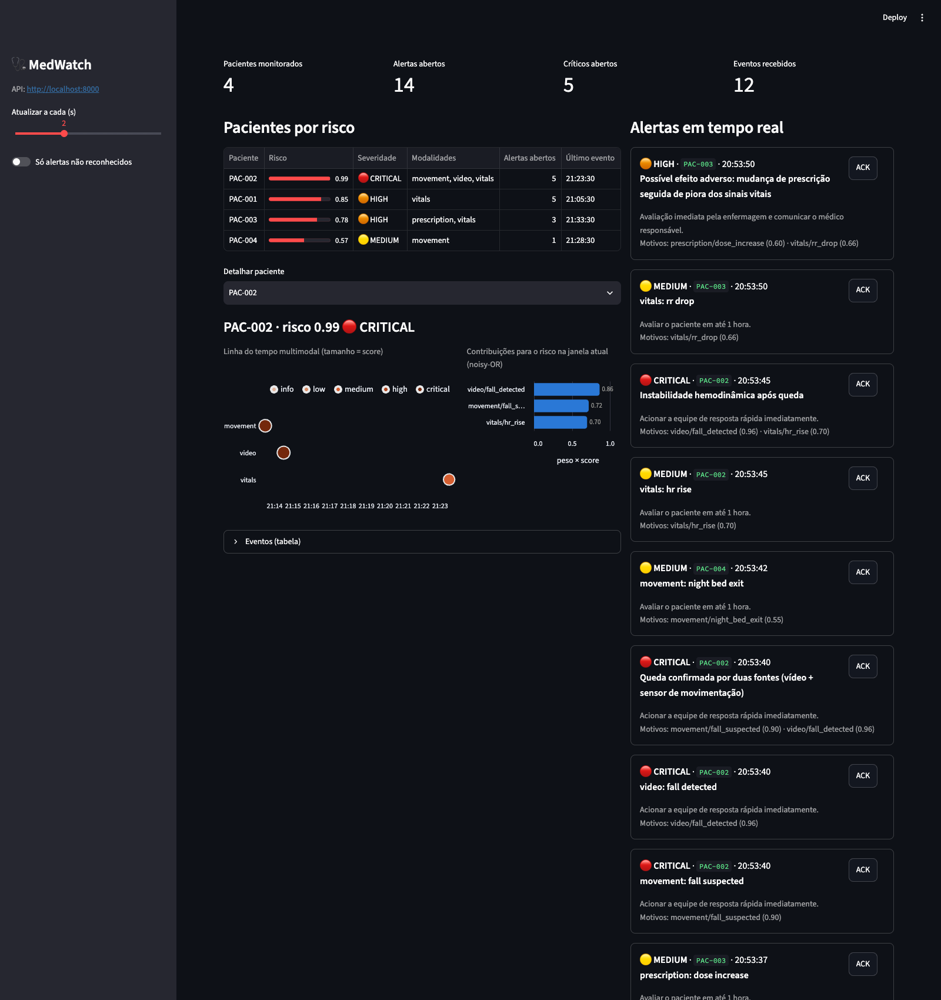
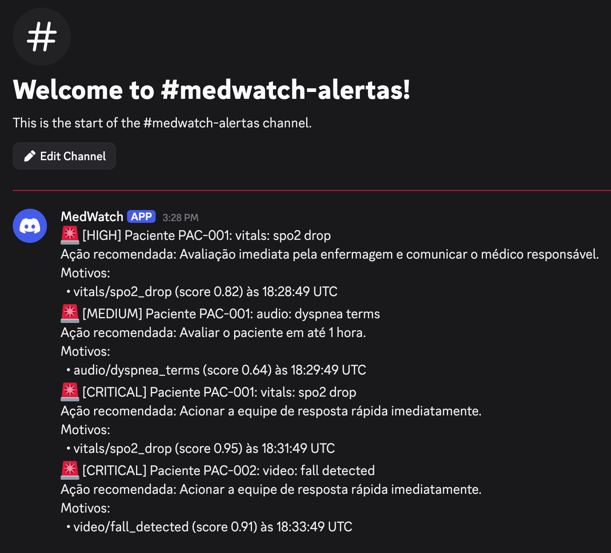

# MedWatch: monitoramento multimodal de pacientes

**Tech Challenge, Fase 4 · Pós-Tech IA para Devs (FIAP) · Grupo 54**

Repositório: https://github.com/oryange/tech-challenge-group-54

## 1. Resumo

O MedWatch monitora pacientes internados a partir de dados de várias modalidades:

| Modalidade | Fonte |
|---|---|
| Vídeo | sessões de fisioterapia e quedas |
| Áudio | consultas |
| Sinais vitais | MIMIC-IV |
| Prescrições | MIMIC-IV |
| Movimentação no leito | série de atividade |

Cada módulo detecta anomalias na sua modalidade e emite eventos clínicos padronizados. Um motor de fusão (`RiskEngine`) combina esses eventos por paciente, numa janela de tempo, e o gerenciador de alertas entrega à equipe médica o que precisa de atenção, em tempo real. Os canais de entrega são o console, um histórico JSONL, um webhook para Teams, Slack ou Discord e um dashboard com WebSocket.

A análise de áudio usa **Azure Speech to Text** e **Azure AI Language (Text Analytics)**, como exige o enunciado. O vídeo usa **OpenPose** e **YOLOv8**.

| Módulo | Técnicas | Resultado principal |
|---|---|---|
| Vídeo | YOLOv8-pose e OpenPose (CMU) + regras biomecânicas; YOLOv8 + ByteTrack para objetos | Quedas no UR Fall (validação): 6/10 com 0 alarmes falsos (YOLOv8) |
| Áudio | Azure Speech + Azure Language + acústica local (parselmouth) | Termos críticos com negação; dispneia detectada na consulta com Azure real |
| Sinais vitais | NEWS2 + z-score robusto + Isolation Forest | F1 combinado 0,882 (anomalias injetadas em 116 internações reais) |
| Prescrições | Regras (salto de dose, duplicidade, suspensão) + Isolation Forest | F1 das regras 0,878–0,899 (178 internações reais) |
| Movimentação | Regras de duração e de pico sobre a série por minuto | F1 combinado 0,912–0,949 (internações sintéticas) |
| Fusão | Regras cross-modal + noisy-OR ponderado | Cenário de demonstração com 14 alertas, todos conferidos; latência mediana de ~3,5 ms |

## 2. Problema e objetivos

O enunciado pede que o hospital monitore continuamente os pacientes por meio de dados multimodais, para identificar sinais precoces de risco:

- analisar vídeos de cirurgias ou fisioterapia em busca de padrões anômalos;
- processar gravações de voz de consultas, detectando sintomas relacionados à fala (fadiga, disartria);
- detectar anomalias em sinais vitais, prescrições e evolução clínica, alertando a equipe em tempo real;
- integrar serviços gerenciados em nuvem (Azure Cognitive Services, hoje Azure AI Services).

Os objetivos são três: fusão de dados médicos de tipos diferentes, uso de serviços em nuvem e detecção de anomalias em tempo real.

## 3. Fluxo multimodal

```
 Vídeo (fisio, quarto)   Áudio (consulta)        MIMIC-IV demo            Sensor de leito / pose
        │                       │                 │           │                    │
  YOLOv8-pose │ OpenPose   Azure Speech      vitais      prescrições          movimentação
  YOLOv8 + ByteTrack       Azure Language    NEWS2       regras + IF          imobilidade,
  regras biomecânicas      acústica local    z-score     por paciente-dia     saída noturna,
  queda, áreas críticas    termos críticos   Isolation F.                     queda, atividade
        │                       │                 │           │                    │
        └───────────────────────┴──── ClinicalEvent (contrato comum) ─────────────┘
                                                 │
                                     EventBus (asyncio, fan-out)
                                                 │
                         RiskEngine: alerta direto + regras cross-modal + risco combinado
                                                 │
                         AlertManager: severidade mínima, deduplicação, cooldown, escalonamento
                                                 │
                 console · alerts.jsonl · webhook (Teams/Slack/Discord) · API + WebSocket → dashboard
```

**Fusão tardia orientada a eventos** ([ADR 0001](adr/0001-late-fusion-event-driven.md)):
- Cada módulo é desenvolvido e testado isoladamente e emite `ClinicalEvent`s com os mesmos campos: `patient_id` pseudonimizado, `source`, `type`, `timestamp` em UTC, `score` ∈ [0, 1], `severity` e `evidence` explicável.
- A fusão trabalha sobre esses eventos e não sobre os dados brutos. Assim, combinar modalidades com escalas e frequências muito diferentes fica simples: frames de vídeo a 10 Hz, uma consulta de alguns minutos, vitais horários e prescrições diárias.

**Dois caminhos de execução usam o mesmo código:**
- **Lote** (CLI): `medwatch <módulo> analyze` processa um arquivo ou paciente e gera relatório JSON/PNG/HTML; com `--alert`, os eventos vão para o `AlertManager`.
- **Tempo real:** o simulador reproduz cenários roteirizados ou relatórios reais com a cadência acelerada, e a API FastAPI recebe uploads de áudio e vídeo. Os dois publicam no barramento, onde a fusão e os alertas acontecem.

**Tempo dos eventos:** regras e cooldown são avaliados no horário dos eventos, e não no relógio. Por isso o replay de dados históricos gera os mesmos alertas que o tempo real, e um evento que chega atrasado (por exemplo, o vídeo processado depois dos vitais) ainda completa uma regra.

Detalhes de arquitetura, contratos e diagrama de sequência estão em [architecture.md](architecture.md).

## 4. Dados

| Uso | Dataset | Volume | Observação |
|---|---|---|---|
| Sinais vitais | MIMIC-IV Clinical Database Demo 2.2 (PhysioNet, acesso aberto) | 100 pacientes, 140 internações em UTI, 12.292 h | FC, PA, FR, SpO2, temperatura, O2 e consciência |
| Prescrições | MIMIC-IV demo, `hosp/prescriptions` | 14.391 prescrições, 250 internações, 2.121 paciente-dias | Mesmos pacientes dos vitais |
| Fisioterapia | Wikimedia Commons (CC BY / CC BY-SA) | 2 vídeos de agachamento | Vista lateral e posterior |
| Quedas | UR Fall Detection Dataset (Kwolek & Kepski, 2014) | 40 sequências (20 quedas, 20 atividades) | Calibração 01–10, validação 11–20 |
| Consultas | Consultas fictícias sintetizadas com Azure TTS | 2 consultas (normal e dispneia) | Roteiro para voz real em [roteiro_gravacao_audio.md](roteiro_gravacao_audio.md) |
| Movimentação | Internações sintéticas com confusores realistas | 30 pacientes × 7 dias por avaliação | Não há dataset público de movimentação contínua em internação |

Todos os downloads conferem SHA-256 (`medwatch data download`). Os dados brutos não são versionados. O MIMIC é desidentificado e desloca as datas para o futuro (ano ~2100–2200); nos relatórios, os pacientes aparecem como `MIMIC-<subject_id>`.

**Como os módulos são avaliados:**
- Os dados reais de vitais e prescrições não têm rótulo de anomalia. A avaliação **injeta anomalias conhecidas** em internações reais e mede precision, recall e F1.
- A precision é **de injeção**: entre as detecções que surgiram com a injeção, a fração que coincide com uma anomalia injetada. Ela não é a precision clínica, que exigiria rótulos de especialistas.
- Para movimentação, a série "normal" é simulada com confusores (ida à poltrona, falhas de sensor), e os alarmes falsos no paciente normal são medidos à parte.

## 5. Modelos aplicados em cada tipo de dado

### 5.1 Vídeo: análise postural, quedas e áreas críticas

Detalhes em [relatorio_video.md](relatorio_video.md) e [ADR 0002](adr/0002-backends-de-pose.md).

| Componente | Modelo / técnica | Por quê |
|---|---|---|
| Pose (padrão) | **YOLOv8n-pose** (Ultralytics), 17 keypoints COCO | Rápido em CPU (43–105 quadros/s nesta máquina) |
| Pose (requisito do enunciado) | **OpenPose**, rede de corpo original da CMU (COCO-18, Part Affinity Fields) portada para PyTorch | O binário oficial exige CUDA e o OpenCV 5 removeu o importador Caffe. Os keypoints dos dois backends concordam em ~5 px |
| Objetos e áreas críticas | **YOLOv8n** (COCO, 80 classes) + **ByteTrack** | Pessoa em área restrita, objeto não estéril no campo cirúrgico, contagem de instrumentos |
| Regras biomecânicas | Ângulos de joelho, quadril e ombro, assimetria e inclinação do tronco, sobre keypoints suavizados (mediana móvel causal) | Limites por exercício em `configs/video_rules.yaml`, com mensagem e recomendação |
| Repetições | Histerese sobre a métrica (entrada mais frouxa que a meta, duração mínima de 0,5 s) | Detecta, por exemplo, agachamento raso ou flexão excessiva por repetição |
| Queda | Descida do quadril ≥ 25% da altura em ≤ 1 s, seguida de postura horizontal (mediana da razão largura/altura > 1,6) | Separa queda de sentar ou agachar devagar |

O relatório automático (HTML/JSON) traz indicadores, achados com quadro-chave, recomendações e o gráfico das métricas, além do vídeo anotado em H.264. A série de pose em `.parquet` alimenta o módulo de movimentação.

### 5.2 Áudio: Azure Speech, Azure Language e acústica local

| Etapa | Onde | Técnica |
|---|---|---|
| Pré-processamento | Local | PCM 16 kHz mono, validação de formato, tamanho e duração |
| Transcrição | **Azure Speech to Text** (`brazilsouth`) | Reconhecimento contínuo pt-BR, tempo por palavra, diarização opcional |
| Texto | **Azure AI Language** | Sentimento com opinion mining, frases-chave, resumo extrativo e Text Analytics for Health (sintomas, medicamentos, negação) |
| Termos críticos | Local | Dicionário (dispneia, fadiga, dor torácica, sintomas neurológicos, sangramento). Cada menção é classificada como afirmada, negada ou pergunta, e só as afirmadas geram evento |
| Alterações vocais | Local (parselmouth/librosa) | F0 e variação em semitons, jitter, shimmer, HNR, pausas, taxa de fala e de articulação |
| Indicadores | Local | Fadiga, disartria e dificuldade respiratória por z-score contra o baseline (populacional ou de uma consulta anterior do próprio paciente) |

Os indicadores são **triagem, não diagnóstico**. Um termo crítico afirmado da mesma família sobe a severidade do indicador em um nível.

### 5.3 Sinais vitais

Detalhes em [relatorio_vitais.md](relatorio_vitais.md).

| Técnica | Pergunta que responde |
|---|---|
| **NEWS2** (Royal College of Physicians, 2017) | O valor é clinicamente perigoso? Faixas por parâmetro, com severidade pela resposta clínica recomendada e histerese para não realertar a cada oscilação |
| **z-score robusto** (mediana/MAD causal, janela de 12 h, 24 h na temperatura) | Mudou muito em relação ao histórico **do próprio paciente**? |
| **Isolation Forest** (6 sinais + variações horárias, população inteira) | A combinação de sinais é rara **na população**? A severidade tem o NEWS2 do pico como piso |

A grade horária é rotulada pelo fim do intervalo, e assim nenhum evento é datado antes de o dado existir.

### 5.4 Prescrições

Detalhes em [relatorio_prescricoes_movimentacao.md](relatorio_prescricoes_movimentacao.md).

- **Salto de dose:** nova prescrição da mesma droga e via em até 24 h, com dose ≥ 3× ou ≤ ⅓ da anterior. As doses passam por normalização de unidade (mcg/mg/g), e as drogas tituladas por protocolo (insulina, vasoativos) ficam fora da regra.
- **Duplicidade terapêutica:** duas drogas da mesma classe (opioides, anticoagulantes, benzodiazepínicos) ativas juntas por ≥ 24 h.
- **Suspensão precoce:** suspensa em até 4 h e não represcrita nas 24 h seguintes.
- **Isolation Forest por paciente-dia:** dia com volume atípico de prescrições novas, suspensas e alteradas.
- Medicamentos potencialmente perigosos (lista do ISMP) sobem um nível de severidade.

### 5.5 Movimentação durante a internação

Os dados chegam como uma série por minuto com `activity` e `in_bed`, vinda de sensor de leito ou da pose do vídeo.

| Regra | Detalhe |
|---|---|
| Imobilidade prolongada | MEDIUM aos 120 min no leito sem se mover, a referência de reposicionamento do NPIAP/EPUAP, e HIGH aos 240 min |
| Saída noturna do leito | ≥ 3 min fora do leito entre 22h e 6h |
| Queda suspeita | Pico de movimento seguido de pessoa parada fora do leito |
| Queda de atividade | Dia abaixo da metade da mediana dos dias anteriores |

### 5.6 Fusão multimodal

Configurada em `configs/fusion.yaml`. Para cada evento, o `RiskEngine` pode gerar três tipos de alerta:

1. **Alerta direto:** o próprio evento, com a sua severidade. Um evento isolado nunca escala sozinho.
2. **Regra cross-modal:** combinações de modalidades numa janela de tempo.

| Regra | Combinação | Janela | Severidade |
|---|---|---|---|
| `respiratory_deterioration` | áudio (falta de ar) + vitais (SpO2 ↓ ou FR ↑) | 30 min | critical |
| `fall_confirmed` | vídeo (queda) + sensor de movimentação (queda suspeita) | 5 min | critical |
| `post_fall_instability` | queda + vitais (FC ↑, PAS ↓, NEWS2 ↑) | 30 min | critical |
| `adverse_drug_event` | prescrição (aumento de dose, duplicidade) **seguida** de piora dos vitais | 6 h | high |
| `neuro_change` | áudio (sintoma neurológico, disartria) + queda ou saída noturna | 60 min | high |

3. **Risco combinado:** noisy-OR ponderado `R = 1 − Π(1 − wₛ · scoreᵢ)` na janela de 30 min.
   - Os pesos por fonte são: vitais 1,0 · vídeo 0,9 · movimentação 0,8 · áudio 0,7 · prescrição 0,6.
   - Cada (fonte, tipo) conta uma vez, pelo maior score, porque três quedas de SpO2 seguidas não são três evidências independentes.
   - O alerta só sai com ≥ 2 modalidades e quando a faixa de R supera o pior evento individual. Assim, dois sinais fracos de modalidades diferentes podem somar um alerta que nenhum deles daria sozinho.

O `AlertManager` aplica depois a severidade mínima, a deduplicação por paciente e tipo de alerta, e o cooldown. Uma piora de severidade sempre é entregue, mesmo dentro do cooldown.

## 6. Resultados

### 6.1 Vídeo

**Detecção de quedas (UR Fall).** Os limiares foram calibrados só nas sequências 01–10; as 11–20 ficaram separadas para validação.

| Backend | Calibração (01–10) | **Validação (11–20)** | Alarmes falsos (validação) |
|---|---|---|---|
| YOLOv8-pose | 9/10 | **6/10** | **0/10** |
| OpenPose | 9/10 (1 alarme falso) | **4/10** | **0/10** |

As quedas perdidas são casos difíceis:
- a descida acontece antes de a pessoa aparecer em pé (`fall-13`, `fall-18`);
- a postura final fica em 1,54, logo abaixo do limiar (`fall-17`);
- a descida é de só 22% da altura (`fall-20`).

A regra prioriza não gerar alarme falso.

**Desvios em exercícios:**

| Vídeo | Backend | Repetições | Achados |
|---|---|---|---|
| Agachamento unipodal | YOLOv8 / OpenPose | 3 | 3 × compensação com inclinação anterior do tronco (até 69°; limite 40°) |
| Agachamento com barra | YOLOv8 | 2 | 2 × flexão de joelho além do limite seguro (46°; limite 60°) |
| Agachamento com barra | OpenPose | 2 | 2 × flexão excessiva + 1 × assimetria de joelhos |



### 6.2 Áudio (Azure real)

Os recursos Speech e Language estão no plano gratuito (F0), em Brazil South. O `medwatch healthcheck --online` passou nos quatro checks do Azure, e o `pytest -m azure` passou.

Consulta com dispneia, transcrita e analisada pelo Azure:

```
Consulta PAC-001: 60 s · 81 palavras · sentimento mixed
  Resumo (extrativo): Acordei várias vezes com falta de ar. Vou ajustar o oxigênio e pedir uma gasometria. ...
  Termos críticos afirmados: falta de ar, cansada, me canso, sem ar, cansaco para respirar, cansaco
  Negados (sem evento): dor no peito
  Eventos: [MEDIUM] dyspnea_terms · [LOW] fatigue_terms · ...
```

Na consulta normal, "falta de ar", "dor no peito" e "tontura" ficam como negadas ou como pergunta do médico, e não geram evento de termo.



### 6.3 Sinais vitais

Avaliação com anomalias injetadas em 116 internações reais com pelo menos 24 h de dados: 283 injeções com a seed 42.

| Método | Precision | Recall | F1 |
|---|---|---|---|
| z-score robusto | 1,000 | 0,767 | 0,868 |
| Isolation Forest | 0,949 | 0,191 | 0,318 |
| NEWS2 | 0,753 | 0,187 | 0,300 |
| **Combinado** | **0,940** | **0,830** | **0,882** |

Com a seed 7, o combinado tem F1 de 0,860. Cada técnica cobre um caso:
- o z-score pega desvios abruptos em relação ao próprio paciente;
- o NEWS2 classifica o risco absoluto;
- o Isolation Forest captura pioras graduais, que o baseline do z-score acompanha e não vê (seção 6.6).

### 6.4 Prescrições

Anomalias injetadas em 178 internações reais com pelo menos 3 dias de prescrições.

| Método | P (seed 42) | R | F1 | F1 (seed 7) |
|---|---|---|---|---|
| Regras | 0,874 | 0,883 | 0,878 | 0,899 |
| Isolation Forest | 0,667 | 0,021 | 0,040 | 0,050 |
| **Combinado** | **0,869** | **0,886** | **0,877** | **0,897** |

Nos dados reais sem injeção, são **0,16 alerta ≥ medium por paciente-dia**. Os limiares saíram dessas medições:
- com salto de 2× seriam 972 eventos, porque dobrar a dose é ajuste de rotina;
- com 3×, são 162.

O Isolation Forest quase não detecta injeções isoladas. O papel dele é marcar **dias** atípicos como um todo, como o dia de uma admissão com 43 prescrições novas.

### 6.5 Movimentação

Avaliação em 30 internações sintéticas × 7 dias, com uma injeção de cada tipo por internação.

| Tipo | F1 (seed 42) | F1 (seed 7) |
|---|---|---|
| Imobilidade prolongada | 0,982 | 0,990 |
| Saída noturna do leito | 1,000 | 1,000 |
| Queda suspeita | 0,776 | 0,824 |
| Queda de atividade | 0,868 | 0,966 |
| **Combinado** | **0,912** | **0,949** |

Nas internações normais, a queda pelo sensor gera **26 a 27 alarmes falsos em 210 paciente-dias**, todos em transferências bruscas para a poltrona. O sensor sozinho não distingue poltrona de chão, e por isso a fusão tem a regra `fall_confirmed`, que exige também a queda vista no vídeo.

### 6.6 Exemplo real: paciente MIMIC-10004235, internação de 24/02 a 05/03

O mesmo paciente aparece nos sinais vitais e nas prescrições, o que permite mostrar a fusão sobre dados reais.



**Sinais vitais:**
- NEWS2 8 (critical) na admissão, em 24/02 às 17:00;
- SpO2 90% contra um baseline de 97,5% (z = −5,1);
- FR 26–30 contra um baseline de 14–15.

Nas últimas 36 h, a FR sobe gradualmente de ~20 para 40+. O baseline do z-score acompanha essa subida e não alerta, e quem sinaliza a piora é o **Isolation Forest**, com 4 episódios. Com o NEWS2 do pico como piso, esses episódios saem como critical.



**Prescrições:**
- cloreto de potássio de 40 para 10 mEq (alto risco, high);
- dia da admissão com 43 prescrições novas (Isolation Forest);
- vancomicina oral de 125 para 500 mg;
- heparina suspensa após 3 h e não represcrita;
- amiodarona de 600 para 150 e de volta a 600 mg.

**Fusão (replay dos dois relatórios no `RiskEngine`):**
- O aumento de amiodarona em 26/02 às 16:00 seguido do NEWS2 subindo às 17:00 e às 20:00 e de queda de SpO2 às 19:00 gera `fusion.adverse_drug_event` (HIGH).
- A regra é **ordenada**: uma piora anterior à prescrição não é atribuída a ela. Uma versão anterior, sem essa ordem, chegou a atribuir ao remédio uma queda de FC que aconteceu 2 h antes do aumento; isso foi corrigido na revisão do PR da fusão.
- Isso é **associação temporal, não causalidade**. A sequência 600 → 150 → 600 mg da amiodarona é compatível com a troca entre dose de ataque e de manutenção. O sistema garante que a mudança de um medicamento de alto risco seguida de piora não passe despercebida; quem decide se é esperado é a equipe.

### 6.7 Fusão e tempo real: cenário de demonstração

O cenário `configs/scenarios/demo.yaml` tem 4 pacientes fictícios em 40 minutos de internação. O `medwatch simulate` confere o resultado contra a sequência documentada:

| Min | Paciente | Alerta | Severidade | Por quê |
|---|---|---|---|---|
| 3 | PAC-001 | `fusion.risk_score` | medium | FC ↑ (low) + cansaço na consulta (low): nenhum alertaria sozinho |
| 6 | PAC-001 | `audio.dyspnea_terms` / `fusion.risk_score` | medium / high | relata falta de ar; o risco combinado sobe |
| 10 | PAC-001 | `vitals.spo2_drop` / `fusion.respiratory_deterioration` | high / **critical** | SpO2 88% + falta de ar |
| 15 | PAC-003 | `prescription.dose_increase` | medium | morfina IV triplicada |
| 20–21 | PAC-002 | `movement.fall_suspected`, `video.fall_detected`, `fusion.fall_confirmed` | critical | queda vista pelo sensor e pelo vídeo |
| 25 | PAC-004 | `movement.night_bed_exit` | medium | evento isolado: não escala |
| 30 | PAC-002 | `vitals.hr_rise` / `fusion.post_fall_instability` | medium / **critical** | taquicardia após a queda |
| 40 | PAC-003 | `vitals.rr_drop` / `fusion.adverse_drug_event` | medium / **high** | FR 8 irpm 25 min depois do aumento do opioide |

Saíram 14 alertas enviados, 2 suprimidos pelo cooldown e 2 eventos LOW sem alerta. A **latência do evento ao alerta** teve mediana de ~3,5 ms e máximo abaixo de 6 ms, e o teste de integração exige < 2 s.



## 7. Integração com o Azure

| Serviço | Uso | Configuração |
|---|---|---|
| **Azure Speech to Text** | Transcrição contínua das consultas em pt-BR; síntese das consultas fictícias (TTS) | Recurso `medwatch-speech-*`, Free F0, Brazil South |
| **Azure AI Language** (Text Analytics) | Sentimento com opinion mining, frases-chave, resumo extrativo, Text Analytics for Health | Recurso `medwatch-language-*`, Free F0, Brazil South |

- **Credenciais:** ficam só no `.env`, fora do git e barrado por hooks de detecção de segredos, e são `SecretStr` no código.
- **Configuração:** `medwatch healthcheck --online` confere configuração e conectividade. O passo a passo de provisionamento está no README e em `scripts/provision_azure.sh`.
- **Resiliência:** retry com backoff em erros transitórios (429/5xx) e timeout por transcrição.
- **Modo mock:** `MEDWATCH_AZURE_MOCK=true` reaproveita respostas reais gravadas com `--record`. É o modo usado no CI.
- **Resumo abstrativo:** não existe em Brazil South, então o sistema usa o resumo extrativo.
- **Barramento:** é uma interface (`EventBus`). Um adapter para Azure Event Hubs pode substituí-lo sem mudar produtores nem consumidores.

## 8. Alerta à equipe médica

| Canal | Conteúdo |
|---|---|
| Console | Alerta legível com severidade, motivos e ação recomendada |
| `outputs/alerts/alerts.jsonl` | Histórico completo, um alerta JSON por linha |
| Webhook (Teams, Slack, Discord) | Resumo do alerta, **sem** o `evidence` dos eventos |
| API + WebSocket `/ws/alerts` + dashboard | Pacientes por risco, feed em tempo real, ACK e linha do tempo multimodal |

- Cada alerta traz os eventos que o motivaram (`reasons`) e uma ação recomendada pela severidade. Por exemplo, CRITICAL: "Acionar a equipe de resposta rápida imediatamente".
- O cooldown só começa a contar quando pelo menos um canal entrega o alerta. Se todos os canais falharem, a repetição seguinte é tentada de novo. Uma falha só no webhook não reabre o envio, porque o console e o `alerts.jsonl` já registraram o alerta.
- As entregas correm em paralelo, para que um CRITICAL não espere os retries de alertas anteriores.

Com o webhook do Discord configurado no `.env`, o `medwatch alerts demo` entrega no canal os 4 alertas do cenário, um por vez e na ordem dos eventos (no tempo real as entregas continuam em paralelo). O SpO2 repetido dentro do cooldown é suprimido, e a atividade baixa (LOW) não gera alerta. As mensagens levam só o resumo (tipo, score e horário), sem o `evidence`.



## 9. LGPD e ética

Os detalhes estão no [ADR 0003](adr/0003-lgpd-audio-azure.md).

- **Vídeo:** nunca sai do ambiente local.
- **Áudio:** vai ao Azure em `brazilsouth`, sem transferência internacional e por stream, sem arquivo intermediário. Todas as chamadas ao Language passam `disable_service_logs=True`, porque sem isso o serviço pode guardar o texto por até 48 h.
- **Transcrições, resumos e frases-chave:** ficam só no relatório local. Eventos, alertas e webhook levam apenas metadados (categoria, termos do dicionário, contagens, z-scores).
- **Identificadores:** são pseudonimizados (`PAC-001`, `MIMIC-<id>`). O `patient_id` aceita só `[A-Za-z0-9_-]` e é validado antes de virar nome de arquivo.
- **Logs:** não trazem áudio, transcrição nem chaves.
- **Natureza dos resultados:** todos os indicadores são de **triagem**. Os alertas apoiam a equipe e não substituem o julgamento clínico.

## 10. Limitações

- **Precision de injeção:** as métricas de vitais, prescrições e movimentação medem o quanto o sistema recupera anomalias injetadas, e não a acurácia clínica, que exigiria rótulos de especialistas.
- **Fusão sem calibração:** pesos, faixas e janelas são heurísticos. Não há dataset público com várias modalidades do mesmo paciente para calibrá-los.
- **Movimentação sintética:** não há dataset público de sensor de leito com rótulos. A queda pelo sensor gera alarmes falsos em transferências para a poltrona, e no alerta direto ela ainda sai como CRITICAL antes da confirmação pelo vídeo.
- **Áudio:**
  - as consultas de exemplo são sintetizadas;
  - com o baseline populacional, a consulta normal gera um falso positivo de disartria, porque o áudio tem dois falantes e o baseline de jitter/shimmer vem de vogal sustentada;
  - com `--baseline` de uma consulta anterior do mesmo paciente, o falso positivo some.
- **Vídeo:**
  - os ângulos são 2D, e a vista posterior distorce a flexão;
  - os pesos COCO não reconhecem instrumental cirúrgico específico;
  - as quedas foram avaliadas com uma única câmera frontal, em 40 sequências.
- **Prescrições:** usam o início e o fim da prescrição, e não a administração efetiva.
- **API e dashboard:** não têm autenticação e escutam só em `127.0.0.1`. O estado fica em memória, e o histórico permanente fica nos arquivos JSONL.

## 11. Trabalhos futuros

- Calibrar a fusão com dados multimodais reais do mesmo paciente.
- Rebaixar a queda só pelo sensor até a confirmação pelo vídeo.
- Medir as features acústicas só nos trechos do paciente (diarização) e recalibrar o baseline para fala conversacional.
- Validar as quedas nas sequências 21–40 do UR Fall, que ficaram intocadas.
- Fazer fine-tuning do YOLOv8 para instrumental cirúrgico (ex.: m2cai16-tool-locations).
- Adicionar autenticação na API (proxy com OAuth/mTLS) e persistir o estado.
- Usar o adapter de Azure Event Hubs para o barramento e o BIDMC (1 Hz) no simulador.

## 12. Como reproduzir

```bash
make install                                   # dependências + hooks
medwatch data download                         # MIMIC-IV demo (SHA-256 conferido)
medwatch data download --dataset videos        # vídeos de exemplo
medwatch data download --dataset urfall        # UR Fall

medwatch vitals evaluate                       # métricas da seção 6.3
medwatch prescriptions evaluate                # seção 6.4
medwatch movement evaluate                     # seção 6.5
medwatch video evaluate-falls --backend yolo   # seção 6.1

medwatch vitals analyze --patient 10004235     # exemplo da seção 6.6
medwatch prescriptions analyze --patient 10004235
make demo                                      # cenário da seção 6.7

# Azure (com .env configurado)
medwatch healthcheck --online
medwatch audio analyze data/samples/consulta_02_dispneia.wav --patient PAC-001
```

## Referências

- Johnson, A. et al. *MIMIC-IV Clinical Database Demo* (version 2.2). PhysioNet, 2023.
- Kwolek, B.; Kepski, M. *Human fall detection on embedded platform using depth maps and wireless accelerometer*. Computer Methods and Programs in Biomedicine, 2014 (UR Fall Detection Dataset).
- Royal College of Physicians. *National Early Warning Score (NEWS) 2*, 2017.
- Cao, Z. et al. *OpenPose: Realtime Multi-Person 2D Pose Estimation using Part Affinity Fields*. IEEE TPAMI, 2019.
- Ultralytics. *YOLOv8*, 2023.
- Zhang, Y. et al. *ByteTrack: Multi-Object Tracking by Associating Every Detection Box*. ECCV, 2022.
- Liu, F. T.; Ting, K. M.; Zhou, Z.-H. *Isolation Forest*. ICDM, 2008.
- ISMP. *High-Alert Medications in Acute Care Settings*, 2024.
- NPIAP/EPUAP/PPPIA. *Prevention and Treatment of Pressure Ulcers/Injuries: Clinical Practice Guideline*, 2019.
- Microsoft. *Azure AI Speech* e *Azure AI Language: Text Analytics for Health*, documentação oficial.
