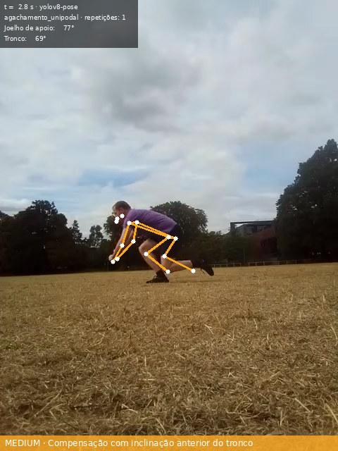
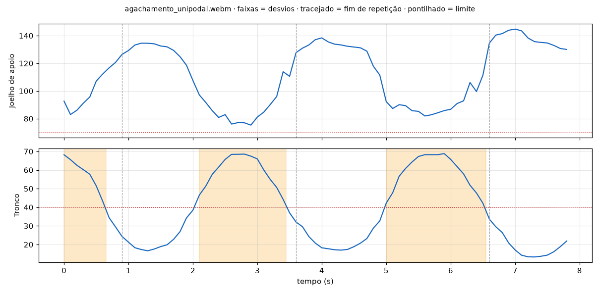
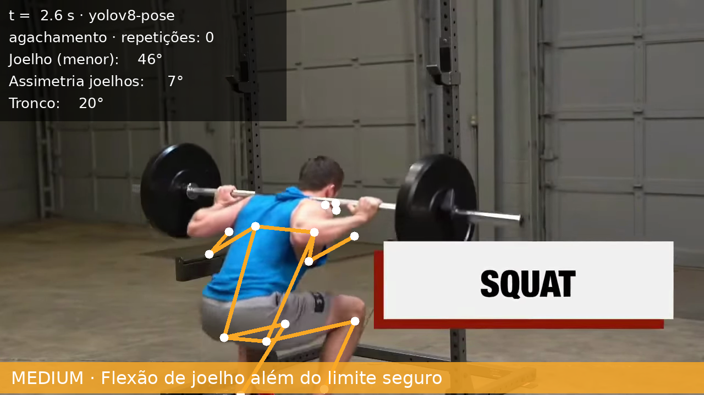
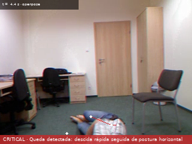

# Análise de vídeo clínico

Seção de referência para o relatório técnico (PR 8). Os resultados são reproduzíveis com:

```bash
medwatch data download --dataset videos
medwatch data download --dataset urfall
medwatch video evaluate-falls --backend yolo
medwatch video evaluate-falls --backend openpose
```

## Fluxo

```
vídeo ─► amostragem (10 quadros/s) ─► pose (YOLOv8-pose | OpenPose CMU) ─► pessoa principal
      │                                                                    (rastreada entre quadros)
      └► objetos (YOLOv8 + ByteTrack, opcional por cena)
                                   ▼
        mediana móvel causal dos keypoints (5 quadros) ─► métricas biomecânicas por quadro
                                   ▼
   regras de exercício (limites + repetições) · queda · áreas críticas · contagem de instrumentos
                                   ▼
       achados ─► ClinicalEvent(source=video) ─► AlertManager · relatório HTML/JSON · vídeo anotado
                                                 série de pose (.parquet → movimentação, PR 6)
```

**Métricas** (`src/medwatch/video/metrics.py`): ângulo dos joelhos (quadril–joelho–tornozelo), joelho da perna de apoio, assimetria entre joelhos, ângulo do quadril e dos ombros (quadril–ombro–cotovelo), assimetria de ombros e **inclinação do tronco** (segmento quadril→ombro em relação à vertical). Na vista lateral, quando um dos lados fica oculto, usa-se o lado visível.

**Regras** (`configs/video_rules.yaml`): cada exercício define limites por quadro (ex.: tronco ≤ 40°), que só viram desvio se durarem pelo menos 0,3 s, e metas por repetição (ex.: elevação ≥ 150°). As repetições são contadas por histerese: começam ao cruzar o limiar de entrada e terminam ao voltar além do limiar de saída. Cada regra traz mensagem, severidade e recomendação, e essas recomendações aparecem no relatório automático.

## Modelos

| Uso | Modelo | Observações |
|---|---|---|
| Pose (padrão) | **YOLOv8n-pose** (Ultralytics) | 17 keypoints COCO; 43–105 quadros/s nesta máquina |
| Pose (requisito OpenPose) | **OpenPose, rede de corpo da CMU** (COCO-18, Part Affinity Fields) em PyTorch | Pesos originais convertidos; 2–11 quadros/s (Apple M, MPS). Ver [ADR 0002](adr/0002-backends-de-pose.md) |
| Objetos e áreas críticas | **YOLOv8n** (COCO, 80 classes) + **ByteTrack** | Pessoas, leito, cadeira, tesoura, celular etc.; áreas definidas por polígono na cena |

No mesmo quadro, os dois modelos de pose concordam em ~5 px nos keypoints de ombro, quadril, joelho e tornozelo.

## Vídeos de exemplo

| Vídeo | Conteúdo | Licença |
|---|---|---|
| `agachamento_unipodal.webm` | Agachamento unipodal, vista lateral, 8 s | CC BY-SA 4.0 (Wikimedia Commons) |
| `agachamento_barra.webm` | Agachamento com barra, vista posterior, 7 s | CC BY 3.0 (Wikimedia Commons) |
| UR Fall Dataset, 40 sequências | 20 quedas e 20 atividades normais (sentar, agachar, deitar), câmera frontal | Uso em pesquisa |

## Resultados

### Desvios em exercícios

```bash
medwatch video analyze agachamento_unipodal.webm --exercise agachamento_unipodal
```

| Vídeo | Backend | Repetições | Achados | Tempo fora do padrão |
|---|---|---|---|---|
| Agachamento unipodal | YOLOv8 | 3 | 3 × compensação com inclinação anterior do tronco (até 69°; limite 40°) | 47% |
| Agachamento unipodal | OpenPose | 3 | os mesmos 3 achados | 43% |
| Agachamento com barra | YOLOv8 | 2 | 2 × flexão de joelho além do limite seguro (46°; limite 60°) | 14% |
| Agachamento com barra | OpenPose | 2 | 1 × flexão excessiva + 1 × assimetria de joelhos | 11% |





*Inclinação do tronco ao longo do vídeo: o pontilhado marca o limite de 40°, as faixas marcam os desvios e o tracejado marca o fim de cada repetição. A compensação aparece no fundo de cada uma das 3 repetições.*



Na vista posterior o OpenPose é menos estável que o YOLOv8 (perdeu uma das flexões e marcou uma assimetria), o que é coerente com a menor confiança dos keypoints de joelho e tornozelo vistos de trás.

**Execução correta × incorreta.** Nos testes automatizados, com esqueletos sintéticos de ângulos conhecidos, agachamentos corretos (fundo de 85°, tronco 20°) geram 3 repetições e **nenhum** desvio, e agachamentos incorretos (fundo de 50°, tronco 60°) geram 3 desvios de flexão excessiva e de inclinação do tronco. Para o vídeo de demonstração, o grupo vai gravar o mesmo exercício nas duas versões.

### Detecção de quedas

**Regra:** o quadril desce pelo menos 25% da altura da pessoa em pé em até 1 s, e nos 3 s seguintes a pessoa fica na horizontal (mediana móvel de 3 quadros da razão largura/altura da caixa > 1,6). A mediana tolera os quadros em que o estimador perde a pessoa caída.

**Calibração honesta:** os limiares foram escolhidos **só** com as sequências 01–10 do UR Fall. As sequências 11–20 ficaram separadas para validação, sem ajuste posterior.

| Backend | Conjunto | Quedas detectadas | Alarmes falsos | Precision |
|---|---|---|---|---|
| YOLOv8-pose | calibração (01–10) | 9/10 | 0/10 | 1,00 |
| YOLOv8-pose | **validação (11–20)** | **6/10** | **0/10** | **1,00** |
| OpenPose | calibração (01–10) | 9/10 | 1/10 | 0,90 |
| OpenPose | **validação (11–20)** | **4/10** | **0/10** | **1,00** |



**Como chegamos à regra (registrado para o relatório):**
1. **Velocidade instantânea do quadril:** 6/10 na calibração. Quedas e atividades se sobrepõem (uma queda a 0,53 altura/s, uma atividade de deitar a 1,02).
2. **Postura "sustentada"** (largura/altura > 1,8 por 0,5 s seguidos): 4/10. Com a pessoa no chão, a razão oscila (1,4 → 2,1 → 1,7) e a pose falha em alguns quadros.
3. **Regra atual**, com descida em 1 s e mediana da postura: 9/10 na calibração e 6/10 na validação, sempre com zero alarmes falsos.

**Quedas perdidas na validação:** em `fall-13` e `fall-18` a descida acontece antes de a pessoa estar visível em pé, sem transição observável. Em `fall-17` a postura final fica em 1,54, logo abaixo do limiar. Em `fall-20` a descida é de 22%. A regra prioriza **não gerar alarmes falsos**, porque em monitoramento contínuo o excesso de alarmes leva a equipe a ignorá-los.

### Desempenho

| Vídeo (resolução) | YOLOv8-pose | OpenPose |
|---|---|---|
| UR Fall (320×240) | ~80–105 quadros/s | ~11 quadros/s |
| Agachamento unipodal (480×640) | ~53 quadros/s | ~5,6 quadros/s |
| Agachamento com barra (1280×720) | ~43 quadros/s | ~2,1 quadros/s |

Com amostragem de 10 quadros/s, o YOLOv8 processa mais rápido que o tempo real em todos os casos. O OpenPose processa em tempo real só em baixa resolução.

## Saídas

Para cada vídeo, em `outputs/reports/video/`:

- `<vídeo>_<backend>.html`: relatório autocontido com indicadores, achados com quadro-chave, recomendações, gráfico de métricas e repetições;
- `<vídeo>_<backend>.json`: resumo, repetições e `ClinicalEvent`s;
- `<vídeo>_<backend>_anotado.mp4`: vídeo com esqueleto, métricas e faixa de alerta colorida por severidade (H.264);
- `<vídeo>_<backend>_pose.parquet`: série temporal de keypoints e métricas, entrada da análise de movimentação (PR 6).

## Limitações

- **Ângulos 2D:** são projeções no plano da câmera. A vista posterior distorce flexão e inclinação, e a melhor vista para agachamento é a lateral.
- **Instrumental cirúrgico:** os pesos COCO do YOLOv8 não reconhecem instrumentos específicos (detectam "scissors" e "knife"). Para cirurgia real seria preciso fine-tuning (ex.: m2cai16-tool-locations). As regras de campo estéril e contagem estão implementadas e testadas, mas sem vídeo cirúrgico real de validação.
- **Quedas:** foram avaliadas com uma única câmera frontal, em 40 sequências. A regra depende de a pessoa aparecer em pé antes de cair.
- **Limiares de exercício:** são valores de referência genéricos. Na prática, o fisioterapeuta ajusta por paciente em `configs/video_rules.yaml`.
