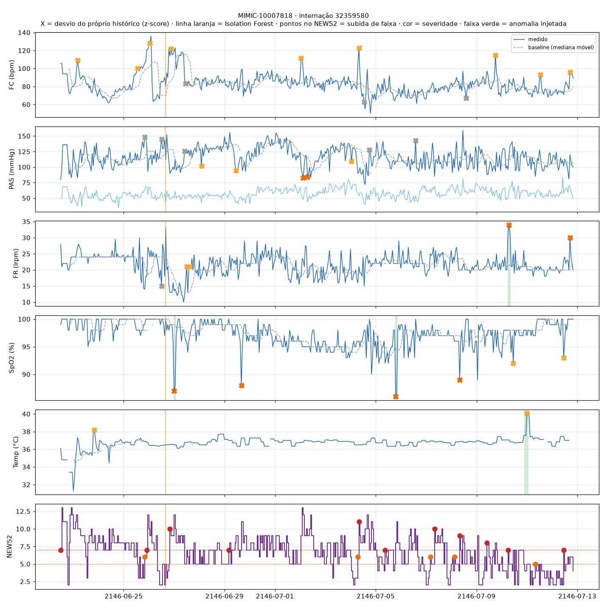
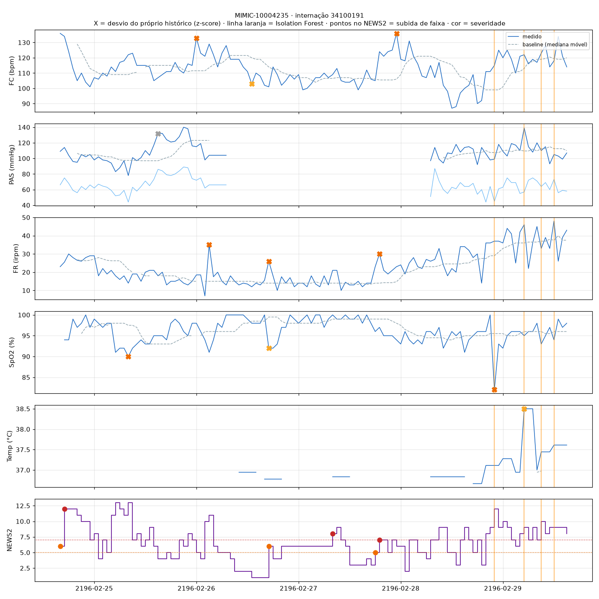

# Detecção de anomalias em sinais vitais

Seção de referência para o relatório técnico (PR 8). Todos os números abaixo são reproduzíveis com `medwatch data download` seguido de `medwatch vitals evaluate`.

## Dados

**MIMIC-IV Clinical Database Demo 2.2** (PhysioNet, acesso aberto): 100 pacientes, 140 internações em UTI e 12.325 horas de monitoramento. As datas do MIMIC são deslocadas para o futuro (ano ~2180) por desidentificação e foram tratadas como UTC.

| Sinal | itemids (icu/d_items) |
|---|---|
| Frequência cardíaca | 220045 |
| Pressão sistólica / diastólica | 220179, 220050 / 220180, 220051 (não invasiva e arterial) |
| Frequência respiratória | 220210, 224690 |
| SpO2 | 220277 |
| Temperatura | 223762 (°C), 223761 (°F → °C) |
| Oxigênio suplementar | 223834 (fluxo), 226732 (dispositivo) |
| Consciência | 220739 (abertura ocular, escala de Glasgow) |

**Pré-processamento:**
- Grade horária com mediana dentro de cada hora (o registro do MIMIC é ~horário: intervalo mediano de 60 min).
- Para o NEWS2, cada valor continua válido por até 4 horas.
- **58 valores descartados como artefato** por estarem fora das faixas fisiológicas de `configs/thresholds.yaml`. Exemplos reais: HR = 0, RR = 0, SpO2 = 29%.
- **Temperaturas em °F digitadas no campo de °C** (ex.: "99 °C") são reconvertidas para °C em vez de descartadas.

## Técnicas

| Técnica | Pergunta que responde | Detalhes |
|---|---|---|
| **NEWS2** (Royal College of Physicians, 2017) | O valor é clinicamente perigoso? | Pontuação por faixas de FR, SpO2, PAS, FC, temperatura, oxigênio e consciência. Severidade pela resposta clínica recomendada: 0 → info · 1–4 → low · parâmetro isolado com 3 pontos → medium · 5–6 → high · ≥ 7 → critical. |
| **z-score robusto** | Mudou muito em relação ao histórico **do próprio paciente**? | Mediana e MAD em janela móvel de 12 h (24 h para temperatura). É **causal**, sem olhar o futuro, como seria em tempo real. Limiar \|z\| ≥ 3,5. A severidade vem dos pontos NEWS2 do sinal no pico: 0 → low, 1–2 → medium, 3 → high. |
| **Isolation Forest** | A combinação de sinais é rara **na população**? | Treinado em todas as internações com os 6 sinais e as variações horárias de FC, PAS, FR e SpO2. Contaminação de 2%. Severidade calibrada nos percentis do score (p99 ≈ 0,52, p99,9 ≈ 0,58). |

Pontos sinalizados separados por até 2 h formam um único **episódio**, que gera um único evento com início, fim e pico.

### Redução de ruído (alert fatigue)

Em UTI o NEWS2 fica alto quase o tempo todo e oscila entre faixas vizinhas a cada hora. Gerar um evento a cada subida de faixa produziu **2.378 eventos de NEWS2** nas 140 internações. Com **histerese** (uma faixa só volta a alertar depois de 6 h abaixo dela), foram **694**.

| Configuração | Eventos totais | Eventos / paciente-dia | Alertas ≥ medium / paciente-dia |
|---|---|---|---|
| Sem histerese | 3.644 | 7,1 | — |
| Com histerese (atual) | 1.960 | 3,8 | 0,73 |

## Avaliação

Os dados reais não têm rótulo de anomalia. Por isso a avaliação injeta desvios conhecidos em internações reais com pelo menos 24 h, com 3 injeções por internação, sem sobreposição e sempre com ao menos 12 h de histórico antes:

| Tipo | Sinal | Desvio | Duração |
|---|---|---|---|
| `spo2_drop` | SpO2 | −10 pontos | 2–4 h |
| `hr_spike` | FC | +40 bpm | 2–4 h |
| `sbp_drop` | PAS | −40 mmHg | 2–4 h |
| `rr_rise` | FR | +12 irpm | 2–4 h |
| `temp_spike` | Temperatura | +2 °C | 2–4 h |

- **Recall:** fração das injeções detectadas, com tolerância de ±1 h.
- **Precision:** entre as detecções que surgiram com a injeção (ausentes na análise da série original), a fração que coincide com uma injeção. Detecções já presentes na série original são anomalias reais sem rótulo e ficam fora da conta. Esta precision mede quantos "efeitos colaterais" a injeção provoca. Ela **não** é a precision clínica real, que exigiria rótulos de especialistas.

### Resultados

| Método | Precision | Recall | F1 | Precision | Recall | F1 |
|---|---|---|---|---|---|---|
| | *seed 42* | | | *seed 7* | | |
| z-score robusto | 0,985 | 0,714 | 0,828 | 0,990 | 0,715 | 0,830 |
| Isolation Forest | 0,983 | 0,194 | 0,325 | 0,982 | 0,187 | 0,314 |
| NEWS2 | 0,788 | 0,173 | 0,284 | 0,900 | 0,176 | 0,295 |
| **Combinado** | **0,945** | **0,777** | **0,853** | **0,972** | **0,778** | **0,864** |

Recall do método combinado por tipo (seed 42): SpO2 0,90 · FC 0,80 · FR 0,78 · temperatura 0,71 · PAS 0,67.

**Leitura dos resultados:**
- O **z-score** é o mais sensível a desvios abruptos porque compara o paciente com ele mesmo: −10 pontos de SpO2 num paciente que vive em 98% é muito diferente do mesmo valor num paciente que vive em 92%.
- O **NEWS2** detecta pouco *nesta avaliação* porque a maioria dos pacientes de UTI já está em faixa alta antes da injeção, e a histerese não realerta. Seu papel é outro: classificar o risco absoluto e definir a severidade.
- O **Isolation Forest** detecta poucas injeções isoladas, mas captura **pioras graduais** que o z-score não vê (próxima seção).
- A temperatura tinha recall de 0,44 com janela de 12 h. Como ela é medida a cada ~4 h, a janela não tinha medições suficientes para formar o baseline. **Com janela de 24 h o recall subiu para 0,71.**



*Faixas verdes = anomalias injetadas; X = detecção por z-score (a cor indica a severidade).*

## Exemplo real: paciente MIMIC-10004235

```bash
medwatch vitals analyze --patient 10004235 --alert
```



Internação de 120 h com 22 eventos. Os principais:

| Horário | Severidade | Evento | Evidência |
|---|---|---|---|
| 24/02 17:00 | critical | `news2_rise` | NEWS2 12 na admissão |
| 25/02 08:00 | high | `spo2_drop` | SpO2 90% (baseline 97,5%, z = −5,1) |
| 26/02 03:00 | high | `rr_rise` | FR 35 (baseline 15, z = 6,8) |
| 27/02 19:00 | high | `rr_rise` | FR 30 (baseline 14, z = 7,2) |
| 28/02 22:00 | high | `spo2_drop` | SpO2 82% (baseline 95,5%, z = −9,1) |
| 28/02 22:00 → 29/02 | low | `multivariate_anomaly` | 4 episódios, NEWS2 9–12 |
| 29/02 05:00 | medium | `temp_rise` | 38,5 °C (baseline 36,8 °C) |

Nas últimas 36 h a FR sobe gradualmente de ~20 para 40+. O **baseline do z-score acompanha a subida** (linha tracejada), por isso o z-score não alerta esse trecho. Quem sinaliza a piora é o **Isolation Forest**, com 4 episódios (linhas laranja), junto do NEWS2 entre 9 e 12. É um exemplo concreto da complementaridade entre as técnicas.

Com `--alert`, os eventos passam pelo `AlertManager`: 16 alertas enviados e 6 eventos de severidade baixa ignorados. No reprocessamento, o cooldown usa o horário clínico dos eventos, e não o relógio do computador.

## Limitações

- **Consciência:** aproximada pela abertura ocular de Glasgow (< 4 = não alerta). Pacientes sedados pontuam 3 de forma permanente.
- **NEWS2:** foi criado para enfermaria. Na UTI, o baseline elevado reduz seu valor discriminativo, o que motiva o z-score individual.
- **Isolation Forest:** é treinado e avaliado no mesmo conjunto (padrão em detecção não supervisionada); com 100 pacientes, o "normal" da população é limitado.
- **Anomalias sintéticas:** são abruptas. Pioras graduais reais, como o exemplo acima, são mais difíceis para o z-score e não estão representadas nas métricas.
- **Precision:** é uma precision de injeção, não clínica (ver Avaliação).
